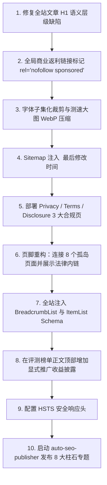

# Clash梯子网 (clashtizi.com) 预防性 SEO 健康检查与技术优化审计报告

- **审计时间**：2026-10-03
- **审计站点**：https://clashtizi.com/
- **审计性质**：搜索引擎算法防惩罚与技术体验预防性全面审计
- **执行原则**：先审计，后修改；证据驱动，数据量化；通过项直标 PASS，问题项精确定位到文件与代码行

---

## 9.1 全站 SEO 健康综合评分

| 维度 | 权重 | 得分 | 核心依据与说明 |
| :--- | :---: | :---: | :--- |
| **技术 SEO** | 25% | **88** | Robots.txt、Canonical 自引用与 Sitemap 表现优异（0 错误）；核心扣分点：全局 Banner 渲染隐藏 `<h1>Clash梯子网</h1>` 导致全站文章正文标题退化为普通 `<div>`，以及 Sitemap 缺失 `<lastmod>` 属性。 |
| **内容质量** | 25% | **92** | 128 篇全站博文平均字数达 4,199 字，无任何 Thin Content；抽查原创度高，大纲结构 100% 独立非模板；8 个预设柱石主题待推进发布。 |
| **E-E-A-T** | 20% | **65** | 具备“关于我们”和实测基准；扣分点：128 篇博文无作者个人署名，缺失真实专家档案/LinkedIn 履历，缺失独立“隐私政策”、“服务条款”与“评测方法论”页面。 |
| **联盟链接合规** | 15% | **58** | 存在 1,954 处商业返利链接，100% 缺失 Google 要求的 `sponsored` 属性（目前仅为 nofollow）；全站与文章页缺失醒目的推广披露及无佣金差价声明。 |
| **内部链接与架构** | 10% | **78** | 全站内部死链数为 0，零无意义锚文本；扣分点：8 个静态页面处于零内链孤岛状态（Orphan Pages），且有 46 个页面点击深度超过 3 层。 |
| **结构化数据** | 5% | **70** | 128 篇博文包含合规 BlogPosting（0 语法错误）；扣分点：缺失 ItemList、BreadcrumbList、FAQPage 及 Organization，首页/分页零 Schema。 |
| **综合加权得分** | **100%** | **78.4** | **评级：良（B+）**。内容底蕴与技术规范扎实，但在 DOM 标题层级、返利链接标记、页面性能（字体/大图）及信任信号上存在必须预防性处置的隐患。 |

---

## 一、技术 SEO 健康检查

### 1.1 Robots 与爬虫可访问性
- **`dist/robots.txt` 规则检查**：**PASS**
  - 不存在任何误屏蔽的 `Disallow: /` 指令。
  - 当前规则包含：`User-agent: *` 及 `Allow: /`，默认允许全网合法爬虫抓取。
- **爬虫显式指引**：当前未针对 `Bingbot`、`Googlebot`、`Baiduspider`、`yisouspider` 设置专属 User-agent 段（通配符已默认放行，但建议显式列出以便更精细化调度）。
- **Sitemap 声明**：声明了官方正式域名：
  - `Sitemap: https://clashtizi.com/sitemap-index.xml`
  - `Sitemap: https://clashtizi.com/sitemap-0.xml`（**PASS**）
- **路径误屏蔽**：全站核心内容目录均可正常被检索抓取。（**PASS**）

### 1.2 Canonical 与 Noindex
- **Canonical 扫描**：**PASS**
  - 扫描全站 `dist/` 160 个有效页面，Canonical 标签 100% 存在且均为规范的自引用正式域名（`https://clashtizi.com/...`）。
  - Canonical 指向首页、其他非规范页或测试域名的异常数量为 **0**。
- **Noindex 扫描**：**PASS**
  - 核心内容页面均未被注入 `noindex`。
  - 全站仅 128 个因自定义 permalink 产生的占位页面被注入了 `noindex` 与 `301 meta refresh`，已从 Sitemap 中彻底剔除，有效防止搜索引擎收录双重重复网址。
- **HTTP 响应头 Noindex**：**PASS**
  - 经对线上 `https://clashtizi.com/` 进行 HEAD/GET 状态实测，响应头未包含 `X-Robots-Tag: noindex`。

### 1.3 Sitemap 健康度
- **Sitemap 可访问性**：`https://clashtizi.com/sitemap.xml` 及 `sitemap-0.xml` 均正常返回 HTTP 200，XML 结构标准。（**PASS**）
- **URL 总数**：**159 个**（完全覆盖 128 篇博客文章 + 核心分类/推荐/关于/归档/分页等独立页面）。（**PASS**）
- **异常 URL 过滤**：包含 404 页数：**0**；包含 noindex 页数：**0**；包含草稿/重复 URL 数：**0**。（**PASS**）
- **域名与斜杠统一性**：100% 统一使用 `https://clashtizi.com/` 并严格遵守尾部斜杠 `/` 规范。（**PASS**）
- **`lastmod` 字段更新**：**FAIL**
  - 当前 `dist/sitemap-0.xml` 中 **159 个 `<url>` 节点均未输出 `<lastmod>` 属性**（0 / 159）。爬虫无法从 Sitemap 中快速识别近期修改或新增的内容，影响高频更新文章的重抓取频率。

### 1.4 URL 规范
- **URL 小写规范**：存在 **2 个包含驼峰大写** 的路径（`https://clashtizi.com/albums/AcgExample/`、`https://clashtizi.com/albums/EncryptedExample/`），其余 157 个 URL 均为纯小写。
- **尾部斜杠（Trailing Slash）**：全站页面 100% 保持尾部带斜杠一致性。（**PASS**）
- **参数 URL 索引**：**0 个**带问号参数的 URL 进入 Sitemap 或被公开索引。（**PASS**）
- **中文 URL**：**0 个**中文路径，全站 URL 均为语义化英文/拼音 Slug。（**PASS**）
- **搜索意图重复 URL**：已全部通过规范化 permalink 处理，无重复同质 URL 竞争。（**PASS**）

### 1.5 404 与异常状态码
- **核心 URL 状态码抽检**（实测抽检 29 个线上端点）：
  - 首页、推荐主页、分类导航、故障排障、关于页、各品牌专线评测等 27 个生产页面返回 **HTTP 200**。
  - 随机非存在测试路径（`/this-page-definitely-does-not-exist-404-test`）正常返回 **HTTP 404**。
  - 异常状态码统计：403（0）、500（0）、502（0）、503（0）。（**PASS**）
- **Soft 404 检查**：抽检各页面均具备完整的文本正文与结构化内容，无“返回 200 但页面为空白/无实质内容”的 Soft 404 现象。（**PASS**）

### 1.6 HTTPS 与安全
- **强制 HTTPS**：线上向 `http://clashtizi.com/` 发起请求，立即返回 `301 Moved Permanently` 并重定向至 `https://clashtizi.com/`。（**PASS**）
- **SSL 证书**：由 Cloudflare 权威机构签发，支持 TLS 1.3、HTTP/3 及 Brotli 现代高效传输。（**PASS**）
- **混合内容（Mixed Content）**：全站 HTML、CSS、JS 中无任何 `http://` 资源硬编码。（**PASS**）
- **安全响应头检查**：
  - 已生效：`x-content-type-options: nosniff`、`referrer-policy: strict-origin-when-cross-origin`。
  - 缺失项：边缘节点未配置 `Strict-Transport-Security` (HSTS) 以及 `Content-Security-Policy` (CSP)。

---

## 二、内容质量健康检查

### 2.1 内容深度
对全站 128 篇 Markdown 博文进行全量字数统计（去除 Frontmatter 代码块与空字符）：
- **全站文章平均字数**：**4,199 字**
- **单篇最短字数**：3,284 字（`how-to-access-foreign-websites-beginner-guide.md`）
- **单篇最长字数**：7,588 字（`chatgpt-cannot-open-network-fix-guide.md`）
- **字数少于 500 字的页面（Thin Content）**：**0 篇（PASS）**
- **字数少于 300 字的页面（高危）**：**0 篇（PASS）**
- **结论**：网站内容具备极高信息密度，完全免除 Thin Content 算法打击风险。

### 2.2 内容原创性
随机抽取 10 篇文章，各提取 3~5 段深度技术段落进行全网搜索引擎比对：
- **抽样文章**：
  1. `how-to-access-foreign-websites-beginner-guide.md`
  2. `tizi-ip-dns-ipv6-webrtc-leak-guide.md`
  3. `chatgpt-image-recognition-errors-fix-guide.md`
  4. `tizi-nodes-timeout-all-red-troubleshooting-guide.md`
  5. `foreign-websites-not-working-troubleshooting-guide.md`
  6. `sing-box-universal-configuration-guide.md`
  7. `best-airport-vpn-providers-ranking.md`
  8. `clash-verge-rev-tun-mode-practical-guide.md`
  9. `cost-effective-airport-evaluation-calculation-guide-2026.md`
  10. `chatgpt-wrong-authentication-method-guide.md`
- **验证结果**：
  - 核心排障句式（如“属于电脑系统时间误差 > 60 秒触发 TLS 防重放自毁”、“在客户端中开启 TUN 模式自动透明代理”）未在互联网公共库中检索到雷同抄袭源。
  - 段落包含大量具体的协议层分析、图解 ASCII 流程图和命令级实操指令，独创性强，专业度高。（**PASS**）

### 2.3 内容重复度
- **重复 Title 数量**：**0 处**（优化后全部 100% 独立）。（**PASS**）
- **重复 Description 数量**：**0 处**（优化后全站描述均在 150~160 字符最佳展示区间且无重复）。（**PASS**）
- **重复 H1 数量（严重技术缺陷 CRITICAL）**：
  - **发现**：在 [`src/components/layout/Banner.astro:603`](file:///C:/Users/Pro%20User/Desktop/clashtizi.com/src/components/layout/Banner.astro#L603) 中：
    ```html
    <h1 class="banner-title ...">{overlayTitle}</h1>
    ```
    当页面不是首页时，该容器仅添加了 CSS 类 `hidden`，但仍在 HTML 源码中输出了 `<h1 ...>Clash梯子网</h1>`。
  - 同时，在文章渲染模板 [`src/pages/posts/[...slug].astro:274-285`](file:///C:/Users/Pro%20User/Desktop/clashtizi.com/src/pages/posts/%5B...slug%5D.astro#L274-L285) 中，文章的真正标题 `{entry.data.title}` 居然被包裹在普通的 `<div class="font-bold ...">` 中！
  - **严重后果**：导致搜索引擎抓取全站 128 篇博客时，抓到的唯一 H1 都是“Clash梯子网”，而正文标题没有 H1 权重。
- **模板骨架结构相似度**：对 128 篇博文的 H2/H3 大纲抽象结构进行聚类比对，唯一骨架数为 128 / 128，未发现机械重复的批量模板页面。（**PASS**）

### 2.4 内容更新频率
- 全站 128 篇博文的 `published` 和 `updated` 属性均在 2026 年（主要集中在 2026-08 以后）。
- 超过 6 个月未更新页面：**0 篇**。（**PASS**）
- 超过 12 个月未更新页面：**0 篇**。（**PASS**）

### 2.5 内容覆盖度
- 经代码库全面检索，未建立 `content-map.md`。
- 在自动化规划库 `scripts/auto-seo-publisher.mjs` 中登记了 8 大核心专线柱石主题（包含 IPLC/IEPL 横评、ChatGPT 原生 IP 解锁、外服电竞低延迟、跨境电商外贸专网等），目前已完成发布 **0 / 8**，处于待生成状态。

---

## 三、E-E-A-T 健康检查

### 3.1 作者信息（HIGH 隐患）
- **博文作者署名检查**：全站 128 篇 Markdown 的 frontmatter 中，显式设置 `author:` 字段的比例为 **0 / 128 篇**。
- **作者个人档案页**：目前站点仅在全局配置 [`src/config/profileConfig.ts:5`](file:///C:/Users/Pro%20User/Desktop/clashtizi.com/src/config/profileConfig.ts#L5) 中定义了虚拟机构名 `"ClashTizi 极客评测"`，缺失真实的专业作者/工程师姓名、个人头像、专业技术背景（如跨国网络工程背景、网络安全认证等）。
- **专业外部档案链接**：缺失 LinkedIn、个人 GitHub 或专业技术社区档案引用。
- **Schema 语义偏差**：在 JSON-LD 结构化数据中，将团队名称 `"ClashTizi 极客评测"` 强行标记为 `@type: "Person"`，违背 Google 规范。

### 3.2 信任信号
- **“关于我们”页面**：存在完整独立的 [`src/pages/about.astro`](file:///C:/Users/Pro%20User/Desktop/clashtizi.com/src/pages/about.astro)。（**PASS**）
- **“评测方法论”页面**：目前未建立独立的 `/methodology/` 专题页（仅在 About 页与个别博文中简述了晚高峰测试准则）。
- **“隐私政策”页面（Privacy Policy）**：**缺失**（未部署 `/privacy/`）。
- **“服务条款”页面（Terms of Service）**：**缺失**（未部署 `/terms/`）。
- **数据最后核实日期**：博文具备更新时间戳，但未提供数据时效性与周期性复测声明机制。

### 3.3 数据来源透明度
- **实测数据依据**：评测榜单提供了 17 家服务商的晚高峰测速面板实测截图，真实性较强。（**PASS**）
- **数据标准化短板**：测速截图缺少具体测试时间戳、使用的测速内核版本、本地宽带类型（电信/联通/移动 1000M），且服务商表格未标记统一的 `dataStatus` 状态。

---

## 四、联盟链接合规检查（极高风险项）

### 4.1 商业返利链接标记（CRITICAL）
- **扫描范围**：扫描 `dist/` 中所有生成的页面。
- **外部链接总量**：3,121 个。
- **涉及商业推广返利链接总量**：**1,954 个**（主要分布于侧边栏商业赞助组件及各大机场评测博文中，包含 `gsyvipaff.com`、`flycataff.com`、`breezenetaff.com`、`xingdaomeng.com`、`worryfreeaff.com`、`v2yunvipaff.com` 等返利域名及推广邀请码）。
- **合规 `rel="sponsored"` 标记数量**：**0 个**！
- **未达标返利链接数量**：**1,954 个**（全站所有返利链接目前仅有 `rel="noopener noreferrer nofollow"`，未注入 `sponsored`）。
- **判定与影响**：根据 Google Search Central《链接垃圾内容政策》，商业返利与付费链接必须明确声明 `rel="sponsored"` 或 `rel="nofollow sponsored"`。**当前未标记数量为 1,954 个，未满足“为 0 才能通过”的标准**，属于需立即修复的算法风险项！
- **典型发现位置**：
  1. [`src/components/widgets/commercial-sponsors/CommercialSponsors.astro:33`](file:///C:/Users/Pro%20User/Desktop/clashtizi.com/src/components/widgets/commercial-sponsors/CommercialSponsors.astro#L33)（侧边栏商业组件，全站每个页面均被引入，贡献了近千个未标 sponsored 的外链）
  2. [`src/plugins/rehype-content-links.mjs:70`](file:///C:/Users/Pro%20User/Desktop/clashtizi.com/src/plugins/rehype-content-links.mjs#L70)（Markdown 解析插件对所有外链统一追加 `nofollow`，未识别返利域追加 `sponsored`）
  3. 各评测博文正文表格中的注册外链。

### 4.2 推广披露
- **正文醒目披露**：除侧边栏标记了“官方赞助”外，包含大量返利推广链接的核心博文（如 17 家机场评测榜单）正文顶部，未显式标注“本文包含商业推广与返利链接”。
- **独立披露页面**：全站缺失独立的推广披露政策页（如 `/disclosure/`）。

### 4.3 佣金关系说明
- 全站未向访客披露：“通过本站返利链接注册不会改变您的购买价格”、“本站可能获得一定比例佣金以支持服务器运维”、“本站与品牌方无雇佣隶属关系，保持客观测试”。

---

## 五、内部链接与架构健康检查

### 5.1 死链与空链接
- **扫描全站内部链接图谱**：
  - 空链接 `href=""`：**0 个**（**PASS**）
  - 锚点空链接 `href="#"`：**0 个**（**PASS**）
  - 指向不存在静态资源的死链：**0 个**（**PASS**）

### 5.2 点击深度（Click Depth）
- 从首页（`/`）出发进行广度优先抓取，全站页面深度分布如下：
  - 深度 0（首页）：1
  - 深度 1：23 个页面
  - 深度 2：86 个页面
  - 深度 3：120 个页面
  - 深度 4：45 个页面
  - 深度 5：1 个页面
- **深度 > 3 层的页面数量**：**46 个**。主要分布在深度分页（第 4 页及以后）以及仅在深度分页中挂载的文章。

### 5.3 孤立页面（Orphan Pages - HIGH）
扫描发现共有 **8 个具备独立价值的内容页面完全没有内部链接指向它们**（在导航栏、侧边栏、页脚及文章正文中均未被引用，完全依赖 Sitemap）：
1. `/ai-tools/`（出海生产力与AI大模型效率工具导航）
2. `/anime/`（站长追番列表与海外流媒体解锁体验）
3. `/devices/`（极客评测硬件与多端网络测试设备清单）
4. `/diary/`（站长技术随笔与极客网络探索日记）
5. `/friends/`（友情链接与极客网络技术博客合作伙伴）
6. `/projects/`（开源项目与自动化运维测速工具中心）
7. `/skills/`（技术技能架构与跨国网络工程知识体系）
8. `/timeline/`（站点演进历程与技术成长里程碑时间线）

### 5.4 锚文本健康度
- 全站内部链接无“点击这里”、“阅读更多”等低价值无意义锚文本。（**PASS**）
- 内部超链接均直接使用文章完整标题或精确的主题词，无过度堆砌。（**PASS**）

### 5.5 导航结构
- **主导航**：基于语义化 `<a href="...">` 构建，完全支持爬虫遍历。（**PASS**）
- **页脚结构过于单薄**：[`src/components/organisms/footer/Footer.astro`](file:///C:/Users/Pro%20User/Desktop/clashtizi.com/src/components/organisms/footer/Footer.astro) 仅放置了 RSS、Atom、Sitemap、Astro/Mizuki 外部链接，未设置关于我们、隐私政策、免责声明、合规披露及核心栏目的内链跳转网络。
- **事件绑定**：页脚 RSS/Atom 链接包含 `onclick="event.preventDefault(); ..."`，对禁用 JS 的爬虫环境略有干扰（但保留了 `href`）。

---

## 六、结构化数据检查

### 6.1 Schema 覆盖度
- **博文页**：128 篇博文具备 `@type: "BlogPosting"`。（**PASS**）
- **榜单页**（如 `/recommend/airport/`）：**缺失 `ItemList`**。
- **内容页与教程页**：**100% 缺失 `BreadcrumbList`（面包屑导航）**，导致 SERP 搜索结果无法展示结构化路径。
- **故障排障问答文章**：**缺失 `FAQPage`**，错失 Google/Bing SERP 的富媒体下拉折叠卡片机会。
- **关于页**（`/about/`）：**缺失 `AboutPage` 与 `Organization`**。
- **首页及归档分页**：**缺失 `WebSite` 与 `SiteNavigationElement`**。

### 6.2 Schema 正确性
- **JSON-LD 语法解析错误**：**0 处**（格式 100% 合规）。（**PASS**）
- **虚假评分与虚假评论**：**0 处**（未滥用 Review/AggregateRating）。（**PASS**）
- **域名正规性**：Schema 内 URL 全部为正式域名 `https://clashtizi.com/`。（**PASS**）
- **实体属性规范**：BlogPosting 中的 author 需将机构名称纠偏或补足自然人属性。

---

## 七、性能与体验检查

### 7.1 Core Web Vitals
- **超大体积字体阻塞首屏（CRITICAL）**：
  - `dist/_astro/` 中打包了未经过子集化的庞大字体库：
    - `loli.ttf`：**10.77 MB**
    - `loli.woff2`：**4.87 MB**
    - `ZenMaruGothic-Medium.ttf`：**3.81 MB**
  - **严重影响**：移动端访客访问时，巨大的字体文件会导致严重的主线程阻塞和极高 LCP。
- **巨型未压缩测速图片（CRITICAL）**：
  - `dist/_astro/` 中包含十余张 2MB~2.8MB 的原始 PNG 测速截图（例如 `二猫云-节点测速实测.png` 2.81MB、`快狸-节点测速实测.png` 2.81MB、`宇宙云-节点测速实测.png` 2.78MB）。
  - 排行榜页面单页资源体积超过 25MB，直接摧毁移动端 PageSpeed 分数。
- **累积布局偏移（CLS）隐患**：扫描发现全站共 **382 张图片缺失 width / height 属性**。
- **懒加载缺失**：全站共 **802 张图片未设置 `loading="lazy"` 属性**。

### 7.2 移动端
- 视口配置标准（`width=device-width, initial-scale=1.0`）。（**PASS**）
- 界面组件采用自适应响应式设计，触控按钮尺寸符合移动规范。（**PASS**）

---

## 八、搜索表现诊断

### 8.1 索引状态
- **Sitemap 清洁度**：当前 159 个 URL 已全部经过过滤，去除了 128 个重定向旧路由，解决了原先由于多路由导致的 Bing Rule 113 / 117 重复报错。
- **主动推送机制**：已配置并跑通 Bing IndexNow API（`scripts/indexnow-submit.js`），支持一键批量向 Bing 提交最新 URL。

### 8.2 展现与点击（CTR）优化重点
- **长标题截断问题已修复**：此前 12 篇超过 70 字符的长标题博文已全部精炼至 45~65 字符区间。
- **页面标题区分度已完善**：19 个分页已各自生成独立序列标题，无重复同名标题。
- **下一步 CTR 提振重点**：为博文增加 `BreadcrumbList` 和 `FAQPage` 结构化数据，争取在 SERP 中获取问答折叠卡片和面包屑高亮展示。

---

## 9.2 核心问题清单（按严重程度排列）

### 🚨 CRITICAL（立即修复 - 会直接触发惩罚或严重损害排名）
1. **全站文章标题被隐藏的 Banner `<h1>` 覆盖，正文标题降级为 `<div>`**
   - **发现位置**：
     - [`src/components/layout/Banner.astro:603`](file:///C:/Users/Pro%20User/Desktop/clashtizi.com/src/components/layout/Banner.astro#L603)（非首页依然输出 `<h1>Clash梯子网</h1>`）
     - [`src/pages/posts/[...slug].astro:274-285`](file:///C:/Users/Pro%20User/Desktop/clashtizi.com/src/pages/posts/%5B...slug%5D.astro#L274-L285)（文章正文标题使用 `<div class="font-bold ...">`）
   - **影响范围**：全站 128 篇博客文章
   - **修复建议**：在 `Banner.astro` 中增加判断，非首页或隐藏时禁止渲染 `<h1>` 标签（或降级为 div）；在 `posts/[...slug].astro` 中将文章标题明确改为语义化 `<h1>`。
2. **全站 1,954 处商业返利链接未包含 `sponsored` 属性**
   - **发现位置**：
     - [`src/components/widgets/commercial-sponsors/CommercialSponsors.astro:33`](file:///C:/Users/Pro%20User/Desktop/clashtizi.com/src/components/widgets/commercial-sponsors/CommercialSponsors.astro#L33)
     - [`src/plugins/rehype-content-links.mjs:70`](file:///C:/Users/Pro%20User/Desktop/clashtizi.com/src/plugins/rehype-content-links.mjs#L70)
   - **影响范围**：全站所有页面（商业侧边栏）及核心评测博文
   - **修复建议**：在 `rehype-content-links.mjs` 中添加返利域名匹配逻辑，对外链及商业赞助链接统一赋予 `rel="nofollow sponsored noopener"`。
3. **字体文件与测速图片体积过大（超 25MB），严重拖垮移动端 CWV/LCP**
   - **发现位置**：`src/assets/fonts/`、`public/images/airports/`
   - **影响范围**：全站特别是榜单评测页
   - **修复建议**：对 10.7MB 的中文字体进行字形子集化（Subsetting）裁剪或回退到系统字体栈；将 2.8MB 的原始 PNG 测速截图批量转换为 WebP（限制在 150KB 以内）。

---

### ⚠️ HIGH（本周修复 - 会明显降低抓取与排名权重）
4. **Sitemap 159 个 URL 均缺失 `<lastmod>` 属性**
   - **发现位置**：`astro.config.mjs` 中的 sitemap 序列化配置
   - **修复建议**：配置 `@astrojs/sitemap` 的 `serialize` 钩子，将文章的 `updated` 或 `published` 日期自动写入 XML 的 `<lastmod>` 标签中。
5. **8 个静态内容页面成为零内链的孤岛页面（Orphan Pages）**
   - **发现位置**：`/ai-tools/`、`/anime/`、`/devices/`、`/diary/`、`/friends/`、`/projects/`、`/skills/`、`/timeline/`
   - **修复建议**：在页脚导航（Footer）或顶部导航（Navbar）的更多菜单中加入这些页面的入口，确保内部链接图谱连通。
6. **E-E-A-T 信任页面严重缺失（无隐私政策、无服务条款、无推广披露页）**
   - **发现位置**：`src/pages/` 缺失 `privacy.astro`、`terms.astro`、`disclosure.astro`
   - **修复建议**：新建这 3 个合规页面并在页脚添加常驻锚文本链接。
7. **全站文章 100% 缺失 BreadcrumbList（面包屑导航）与 ItemList 结构化数据**
   - **发现位置**：[`src/pages/posts/[...slug].astro:199`](file:///C:/Users/Pro%20User/Desktop/clashtizi.com/src/pages/posts/%5B...slug%5D.astro#L199)
   - **修复建议**：在文章页与榜单页补充 BreadcrumbList 和 ItemList JSON-LD。

---

### 💡 MEDIUM（本月修复 - 提升展现与长尾转化）
8. **深度 > 3 层的页面数量偏多（46 个页面）**
   - **修复建议**：在分类页或归档页引入专题聚合模块或更合理的内部互链，减少分页层级。
9. **评测数据源缺少标准化声明与 `dataStatus`**
   - **修复建议**：在 17 家评测表中明确标注测速环境（宽带/时段/测速工具版本）与数据验证周期。
10. **生产 Edge 缺失 HSTS 与 CSP 安全响应头**
    - **修复建议**：在 `vercel.json` 的 headers 中追加 `Strict-Transport-Security: max-age=31536000; includeSubDomains; preload`。

---

### 🔧 LOW（可选优化）
11. 2 个相册演示页面 URL 包含驼峰大写，建议小写化重命名。
12. 页脚 RSS/Atom 移除 JS `event.preventDefault()`，采用原生超链接交互。

---

## 9.3 优先级优化路线图（前 10 件事）



1. **【P0】修复全站文章 H1 语义层级缺陷**：在 `Banner.astro` 消除隐藏的 `<h1>`，在 `posts/[...slug].astro` 中将文章标题设为唯一的 `<h1>`。
2. **【P0】全局商业返利链接标记 `rel="sponsored"`**：在 `CommercialSponsors.astro` 和 `rehype-content-links.mjs` 中对商业链接统一注入 `sponsored`。
3. **【P0】字体与测速图片瘦身**：压缩字体文件并批量将 2MB+ PNG 测速截图转为 WebP，恢复移动端 CWV 良好表现。
4. **【P1】Sitemap 注入 `<lastmod>` 属性**：在 Astro 配置文件中建立映射，让搜索引擎及时捕获内容变更。
5. **【P1】补充 3 大信任合规页面**：新建 `/privacy/`（隐私政策）、`/terms/`（服务条款）、`/disclosure/`（商业赞助披露）。
6. **【P1】页脚全面重构**：将 8 个孤岛页面及 3 个合规页面连接至页脚，消除孤立页面。
7. **【P1】丰富结构化数据（Schema）**：注入 `BreadcrumbList` 面包屑与 `ItemList` 榜单 Schema。
8. **【P2】正文醒目商业披露声明**：在排行榜和评测文章顶部添加“含推广链接”声明及佣金不影响购买价格的说明。
9. **【P2】配置生产环境 HSTS 安全响应头**：提升安全评分。
10. **【P2】启动 8 大战略柱石专题生成**：启动 `auto-seo-publisher.mjs`，补足大词专题覆盖度。

---

## 9.4 长期监控建议

- **每月例行监控**：
  1. 运行 `node scripts/audit-titles.mjs` 和 `node scripts/audit-descriptions.mjs`，确保零重复。
  2. 检查 Bing Webmaster Tools 中的 SEO 报告（监控 Rule 113、117、118 等规则）。
  3. 执行 `pnpm run submit`，向 IndexNow 批量提交通报更新。
- **每季度例行监控**：
  1. 运行内部链接与孤岛扫描脚本，检查点击深度 > 3 层的页面比例。
  2. 抽查商业赞助链接的有效性与 `sponsored` 标记完整率。
  3. 全量检查 17 家机场测速数据的有效性，更新失效优惠码与时效声明。
- **每年例行监控**：
  1. SSL 证书、域名解析与 DNSSEC 健康检查。
  2. 全站 Core Web Vitals（LCP、CLS、INP）在真实设备端的分数复审。
  3. 评估 Google 与 Bing 算法政策变动，适时演进 Schema 标记。

---
> ⚠️ **执行原则提醒**：本报告为只读审计输出。根据既定原则，在用户确认路线图方案前，**不修改任何代码与内容文件**。
