> **核心导读 (TL;DR)**：
> 1. **全网首发 42 家机场品牌全景评测**：本文完整汇总并客观评测 42 家主流科学上网机场品牌，根据晚高峰网络实测、专线架构与服务稳定性分层梳理出 **Top 10 核心主推、11 家有图实测大厂、7 家平价自研多端梯队以及 14 家备选品牌库**。
> 2. **真实测速与解锁报告全公开**：所有实测数据严格来源于电信、联通、移动三网晚高峰拥堵时段（20:00 - 23:30）的真实节点测速截图（珠海联通 5G/9G 后端、32 线程测速）、延迟与丢包率记录，以及 Netflix / Disney+ / YouTube / OpenAI ChatGPT 原生解锁测试。
> 3. **线路架构核心标准**：首选 **IEPL / IPLC 企业内网专线**（数据通过跨境光纤点对点直连，不过 GFW 物理防火墙，晚高峰 0 丢包、4K/8K 拖拽秒开），远离容易遭遇 QoS 限速断流的普通公网直连梯子。
> 4. **全平台客户端兼容支持**：支持 **Clash Verge Rev、Sing-box、Shadowrocket (小火箭)、Surge、v2rayN、Quantumult X** 一键扫码导入与通用订阅托管。
> 5. 💡 **商业赞助与返利透明度声明 (Affiliate Disclosure)**：本文包含部分合作品牌的推广链接。如果您通过本站链接注册购买，本站可能会获得少许佣金以维持服务器与长期带宽实测成本，但**绝不会增加您的任何购买费用**（使用独家优惠码可享额外折上折）。所有测速截图与横评结论均基于真实测试，始终坚持客观独立原则，并严格区分「实测记录 (`measured`)」与「品牌方资料说明 (`vendor`)」。
> 6. 🏢 **交互式品牌库入口**：如需按线路类型（IEPL/IPLC）、入门价格档位、是否带实测图或优惠码快速检索对比，请访问 👉 **[2026 全球 42 家机场品牌全库筛选页 (/brands/)](/brands/)**。

---

## 2026 全球 42 家翻墙机场品牌全景速查对照大表

以下为全网 42 家机场品牌的最新核心数据、价格区间、专属优惠码与注册通道（按推荐梯队与综合实测排序）：

| 序号 | 品牌名称 (含详情直达) | 线路类型与协议 | 入门资费与规格 | 独家优惠码 | 测速/解锁证据状态 | 官方注册通道 |
| :---: | :--- | :--- | :--- | :---: | :---: | :---: |
| 1 | [**光速云**](/brands/guangsuyun/) (主推第一) | IEPL专线 + 企业内网双专线 / VLESS | **7.5元/月起** (99元/年 69G/月) | `AMM` (8折) | 🟢 **已实测 (测速+解锁图)** | [官网注册 ↗](https://sahude.gsyvipaff.com/#/?code=keqgvT5Y) |
| 2 | [**暮光加速**](/brands/muguang/) | BGP智能调度 / 专线级出口 | **20元/月** (120GB/月) | `muguang5555` | 🟢 **已实测 (节点测速图)** | [官网注册 ↗](https://varnexa.twilightaff.com/#/?code=D1LHglg3) |
| 3 | [**飞猫云**](/brands/feimaoyun/) | IEPL企业专线 / 纯净落地 | **7元/月起** (84元/年 50G/月) | `flycat888` (8折) | 🟢 **已实测 (节点测速图)** | [官网注册 ↗](https://guangs.flycataff.com/#/?code=6uq0Xe9y) |
| 4 | [**微风网络**](/brands/weifeng/) | IEPL专线 / 轻度办公优化 | **7元/月起** (84元/年 50G/月) | `flat888` (9折) | 🟢 **已实测 (节点测速图)** | [官网注册 ↗](https://edp01.breezenetaff.com/#/?code=t3huofyI) |
| 5 | [**大佬云**](/brands/dalaoyun/) | IEPL专线 / VLESS 协议 | **5.6元/月起** (年付 60G/月) | `dly888` (季付7折) | 🟡 品牌资料核验 | [官网注册 ↗](https://qwerty.dalaoyunaff.com/#/?code=jCPLmoWN) |
| 6 | [**星岛梦**](/brands/xingdaomeng/) | 2020老牌 / 企业专线+不限时包 | **8元/月起** (96元/年 60G/月) | `nmw888` (9折) | 🟢 **已实测 (节点测速图)** | [官网注册 ↗](https://guangs.xingdaomeng.com/#/?code=1TynBYnR) |
| 7 | [**隐形人**](/brands/yinxingren/) | 企业级 IPLC 直连 / 专属客户端 | **24元/月** (144GB/月) | `yxr888` (8折) | 🟡 品牌资料核验 | [官网注册 ↗](https://yinxingren1.invisibleaff.com/#/?code=kcyEeoJT) |
| 8 | [**二猫云**](/brands/ermaoyun/) | IEPL专线 / 4K流媒体优化 | **20元/月** (130GB/月) | `ermao5555` | 🟢 **已实测 (节点测速图)** | [官网注册 ↗](https://guangs.2maoyunaff.cc/#/?code=7mjvgGbW) |
| 9 | [**无忧链接**](/brands/wuyoulianjie/) | IPLC专线 / 订阅免转换直连 | **6元/月起** (轻量套餐) | `wuyou666` | 🟢 **已实测 (测速+解锁图)** | [官网注册 ↗](https://wep01.worryfreeaff.com/#/?code=4ZoSbLdL) |
| 10 | [**唯兔云**](/brands/weituyun/) | 60+节点三网优化 / 智能负载均衡 | **14.9元/月** (100GB/月) | `weitu666` (9折) | 🟢 **已实测 (节点测速图)** | [官网注册 ↗](https://guangs.v2yunvipaff.com/#/?code=xIutqOBA) |
| 11 | [**Firefly**](/brands/firefly/) | 全专线 IPLC / 6档套餐可选 | **16.9元/月** (100GB/月) | `firefly` | 🟡 品牌资料核验 | [官网注册 ↗](https://vip02.fireflyaff.com/#/?code=2n7VURre) |
| 12 | [**宇宙云**](/brands/yuzhouyun/) | IEPL 专线 / VLESS 协议 | **14.9元/月** (100GB/月) | `YUZHOU553` | 🟢 **已实测 (节点测速图)** | [官网注册 ↗](https://wzjc.yuzoucloud.cc/#/?code=yrThwMP1) |
| 13 | [**U1S1**](/brands/u1s1/) | IEPL 专线 / VLESS 协议 | **20元/月** (120GB/月) | `akaka` | 🟢 **已实测 (节点测速图)** | [官网注册 ↗](https://guangs.vipaff.cc/#/?code=xhX5X22f) |
| 14 | [**灵猫网络**](/brands/lingmaowangluo/) | 企业级内网专线 / 不限时包 | **19元/月** (150GB/月) | `lmao888` (9折) | 🟢 **已实测 (节点测速图)** | [官网注册 ↗](https://vip01.civetnet.com/#/?code=8MIAyxak) |
| 15 | [**极连云**](/brands/jilianyun/) | IEPL 专线 / AI 智能调度 | **18元/月** (100GB/月) | `ji8888` | 🟢 **已实测 (节点测速图)** | [官网注册 ↗](https://guangs.jlyvipaff.com/#/?code=VM1rKGUu) |
| 16 | [**光年梯**](/brands/guangnianti/) | IEPL 专线 / 自研多端客户端 | **18元/月** (110GB/月) | `gnt6666` | 🟢 **已实测 (节点测速图)** | [官网注册 ↗](https://guangs.gntaff.com/#/?code=X1FoxjGE) |
| 17 | [**一翻云**](/brands/yifanyun/) | 企业专线 / VLESS 大带宽 | **20元/月** (150GB/月) | `yfy6666` | 🟢 **已实测 (节点测速图)** | [官网注册 ↗](https://guangs.1flyunaff.cc/#/register?code=Yr7FhB7r) |
| 18 | [**SOGO 云**](/brands/sogoyun/) | 高速专线 / 大流量扶持 | **25元/月** (150GB/月) | `sss777` | 🟢 **已实测 (节点测速图)** | [官网注册 ↗](https://guangs.sogoyunaff.cc/#/?code=327Vs0w7) |
| 19 | [**可信云**](/brands/kexinyun/) | 企业专线 / 纯净原生 IP | **25元/月** (150GB/月) | `kkk333` | 🟢 **已实测 (节点测速图)** | [官网注册 ↗](https://guangs.kosingaff.com/#/register?code=UYDtNlCY) |
| 20 | [**速界**](/brands/sujie/) | 极速专线 / 游戏联机优化 | **25元/月** (150GB/月) | `sss1111` | 🟢 **已实测 (节点测速图)** | [官网注册 ↗](https://guangs.speedworldaff.cc/#/register?code=xgXzEfZB) |
| 21 | [**快狸**](/brands/kuaili/) | 跨境高速专线 / 喵速架构 | **25元/月** (150GB/月) | `kkk2222` | 🟢 **已实测 (节点测速图)** | [官网注册 ↗](https://guangs.kuailicloud.cc/#/register?code=AiqyM8oG) |
| 22 | [**全球云**](/brands/quanqiuyun/) | 全球多节点专线 / 多国覆盖 | **20元/月** (120GB/月) | `qqy7777` | 🟢 **已实测 (节点测速图)** | [官网注册 ↗](https://guangs.gcvipaff.com/#/?code=Ov2nvU9C) |
| 23 | [**闪跃**](/brands/shanyue/) | 高速中转专线 / 多协议适配 | **24元/月** (150GB/月) | `shanyue` | 🟡 品牌资料核验 | [官网注册 ↗](https://vip02.flashleapaff.com/#/?code=3lgzm9mm) |
| 24 | [**闪电鼠**](/brands/#shandianshu) | 平价入门 / 轻量体验 | **5.6元/月起** (60GB/月) | `sd88` | 🟡 品牌资料核验 | [官网注册 ↗](https://qwerty.shandianshuaff.com/#/?code=rUE75iYh) |
| 25 | [**云界线**](/brands/#yunjiexian) | 平价专线 / 基础出海 | **5.6元/月起** (60GB/月) | `yjx888` | 🟡 品牌资料核验 | [官网注册 ↗](https://qwerty.yunjiexianaff.com/?code=HBaZ91c6) |
| 26 | [**榴莲云**](/brands/#liulianyun) | 平价中转 / 社交媒体流媒体 | **5.6元/月起** (60GB/月) | `ll88` | 🟡 品牌资料核验 | [官网注册 ↗](https://qwerty.liulianyunaff.com#/?code=hS5pvbfE) |
| 27 | [**神行加速**](/brands/#shenxingjiasu) | 均衡型中转 / 游戏加速 | **14元/月** (120GB/月) | `xs0077` | 🟡 品牌资料核验 | [官网注册 ↗](https://qwerty.shenxingaff.com/#/?code=gawDQqVE) |
| 28 | [**环球梯**](/brands/#huanqiuti) | 平价低门槛 / 常用工具中转 | **5.6元/月起** (60GB/月) | `HQ66` | 🟡 品牌资料核验 | [官网注册 ↗](https://qwerty.huanqiutiaff.com/?code=9I4KRNPH) |
| 29 | [**梯子云**](/brands/tiziyun/) | 自研全平台客户端 / 一键登录 | **22元/月** (120GB/月) | `tiziyun` | 🟡 品牌资料核验 | [官网注册 ↗](https://tiziyun3.ladderaff.com/#/?code=7EmnpHs0) |
| 30 | [**WgetCloud**](/brands/#wgetcloud) | 企业级中转与专线 / 59节点全通 | 季付 ¥297 起 (230G/月) | 待核实 | 🔵 历史实测存档 | [官网注册 ↗](https://invite.wgetcloud.ltd/auth/register?code=VLG2xb) |
| 31 | [**白月光**](/brands/#baiyueguang) | Shadowsocks 多地区专线 | 待核实 | 待核实 | 🔵 历史资料存档 | [官网注册 ↗](https://sibker.com/register?invite_code=gg6puAId) |
| 32 | [**FlyingBird**](/brands/#flyingbird) | 全专线 IPLC / 无倍率不限速 | **15元/月** (100G/月) | `theo` (9折) | 🔵 历史资料存档 | 待核实入口 |
| 33 | [**CyberGuard**](/brands/#cyberguard) | Trojan / VLESS 专线 | **32元/月** (旧资料) | 待核实 | 🔵 历史资料存档 | [官网注册 ↗](https://cyberguard.best/#/register?code=AxXNNYng) |
| 34 | [**龙猫云**](/brands/#longmaoyun) | SS + IPLC 全专线 / 最高 2Gbps | **15元/月** (100G/月) | 季付9折/年8折 | 🔵 历史资料存档 | 待核实入口 |
| 35 | [**FATCAT**](/brands/#fatcat) | 企业级 IEPL / IPLC 内网专线 | **20元/月** (120G/月) | 季付9折/年8折 | 🔵 历史资料存档 | 待核实入口 |
| 36 | [**TNTCloud**](/brands/#tntcloud) | IPLC 内网专线 / 季付限量包 | 季付特惠 / 限量包 | `TNT85` (85折) | 🔵 历史资料存档 | 待核实入口 |
| 37 | [**青云梯**](/brands/#qingyunti) | 6年老牌 / SS + 企业级 IPLC | **18元/月** (100G/月) | `qyt85` (85折) | 🔵 历史资料存档 | 待核实入口 |
| 38 | [**山水云**](/brands/#shanshuiyun) | 多节点中转 / 3档梯度清晰 | **15元/月** (100GB/月) | 待核实 | 🔵 历史实测存档 | [官网注册 ↗](https://sldm1.ssyylf.com/#/register?code=YD5iQ888) |
| 39 | [**灵动云**](/brands/#lingdongyun) | 2025新开 IEPL / VLESS | **20元/月** (100GB/月) | 待核实 | 🔵 历史资料存档 | [官网注册 ↗](https://varnexa.lingdongaff.com/#/?code=wZvEhEoI) |
| 40 | [**浪网**](/brands/#langwang) | IEPL 专线 / 高端商务流量 | **120元/月** (800GB/月) | 待核实 | 🔵 历史资料存档 | [官网注册 ↗](https://varnexa.wavenetaff.com/#/?code=xwAM4tTd) |
| 41 | [**EdgeNova**](/brands/#edgenova) | 直连 / IPLC 自动调度 | **15元/月** (72GB/月) | `TH888` (8折) | 🔵 历史资料存档 | [官网注册 ↗](https://work.edgenovaaff.cc/#/register?code=cl3iB5YG) |
| 42 | [**sslar / 历史备选**](/brands/#sslar) | IEPL+多线 BGP / SS·VLESS | **17元/月起** (Basic 100G) | `ko3eTt0w` (8折) | 🔵 历史资料存档 | 待核实入口 |

---

## 一、Top 10 核心主推机场深度评测 (实测测速图与解锁矩阵)

```text
               【核心前十机场物理网络架构】
 [用户电脑/手机] ──► [客户端 (Clash/小火箭)] ──► [国内 BGP 智能入口] 
                                                        │
                      ══════════════════════════════════╪══════════════════════════════════
                      【IEPL / IPLC 跨境物理光纤专线】 (0 经过 GFW 防火墙，晚高峰 0 丢包)
                      ══════════════════════════════════╪══════════════════════════════════
                                                        │
 [海外原生机房出口 (香港/东京/洛杉矶/新加坡)] ◄──────────┘
      ├──► YouTube 4K/8K 满速拖拽 (0 缓冲)
      ├──► OpenAI ChatGPT / Claude 3.7 原生解锁 (0 封号风控)
      └──► Netflix / Disney+ / HBO 4K 原生画质秒开
```

---

### 1. 光速云 —— 2020老牌 IEPL 双专线综合旗舰（第一主推首选）

- **成立年份**：2020 年稳定运营至今（超 5 年老牌大厂，SLA 99.9% 高保障）。
- **线路架构**：华为云/企业级 **IEPL 纯专线 + 企业内网专线（双线路架构）**，全节点部署新一代 **VLESS 协议**。
- **协议与客户端**：支持自研傻瓜化客户端（下载登录即用），同时完美支持 Clash Verge Rev、Sing-box、Shadowrocket（小火箭）第三方订阅一键导入。
- **节点覆盖**：香港×20、台湾×5、日本×10、新加坡×10、美国×10、马来西亚×2、英国、法国、德国、土耳其、泰国、巴西等全球核心热点机房。
- **套餐规格明细**：
  - **轻量版**：99元/年（折合约 **7.5元/月，69GB/月**），不限设备数，性价比极高，适合日常查资料与轻度视频；
  - **极速版**：25元/月（**168GB/月**），全节点 ×1 倍率，单节点带宽最高达 2.5Gbps；
  - **流光版**：34元/月（**268GB/月**），大流量专线，支持 7×24 小时运维；
  - **量子版/无界版**：68元/月 (568GB) / 138元/月 (900GB)；
  - **致敬斯诺克 147 永久套餐**：147 元一次性付费，**247GB 永久有效不限时**；
  - **企业定制版**：680元/月（500GB/月 独享原生 IP 与独立带宽）。
- **流媒体与 AI 解锁能力**：
  - **AI 工具**：支持 Claude 3.5/3.7、ChatGPT（香港/新加坡原生节点解锁）、Gemini。
  - **流媒体**：Netflix、Disney+、YouTube 4K/8K 秒开、HBO Max、TikTok、Spotify 全区解锁。
- **优惠活动**：输入专属优惠码 `AMM` 立享 **8 折特惠**（半年 9 折 / 年付 8 折 / 两年 75 折 / 三年 7 折）。
- 👉 **[点击直达光速云官方注册通道 ↗](https://sahude.gsyvipaff.com/#/?code=keqgvT5Y)** (优惠码：`AMM`)

#### 📊 光速云真实节点测速图与三网流媒体解锁全套实测报告

光速云在 2026 年多轮实测中保留了涵盖 **2026-08-11 统一测速批次** 与 **2026-08-19 电信 / 移动 / 联通三网跨运营商流媒体解锁及单线程吞吐专项实测** 共 6 张原始证据截图（测试结果仅代表当时测试环境与节点快照，具体体验受用户本地宽带及晚高峰调度影响）：

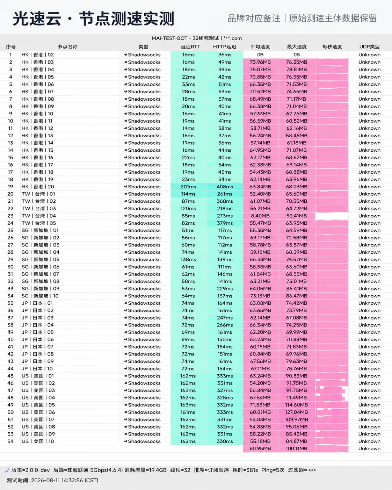
*图注 1：光速云节点测速实测截图。测试时间：2026-08-11 14:32:56（CST）；测速工具：MAI-TEST-BOT 2.0.0-dev（协议显示 Shadowsocks）。注：仅反映当次单日测速快照表现，不直接代表全天候跨运营商体验。*

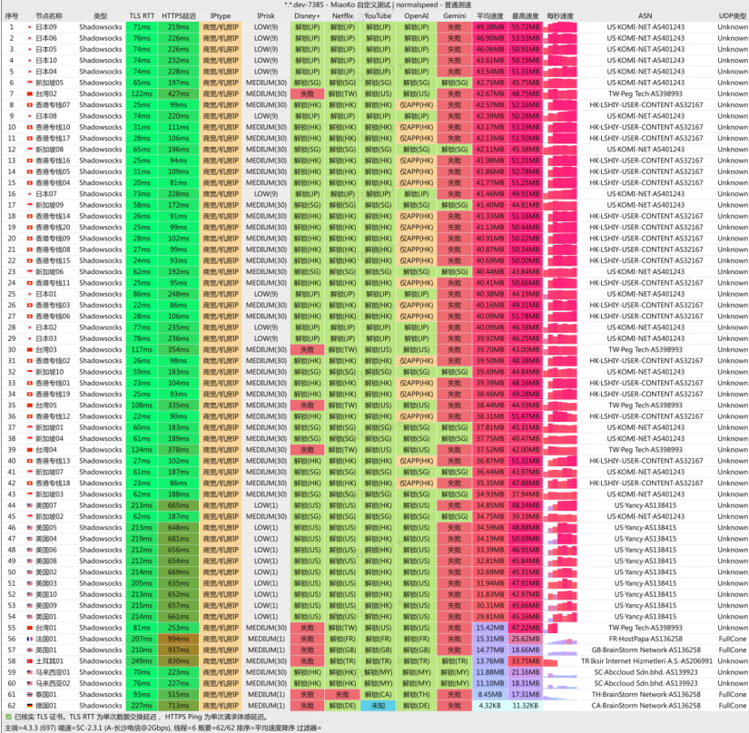
*图注 2：光速云 2026-08-19 长沙电信 @2Gbps 实测 62/62 节点矩阵，涵盖 Disney+、Netflix、YouTube、OpenAI ChatGPT 与 Gemini 解锁状态及单节点吞吐表现。*

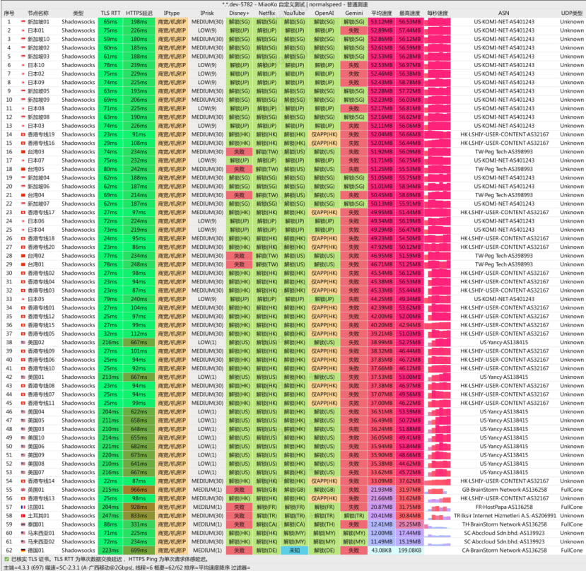
*图注 3：光速云 2026-08-19 广西移动 @2Gbps 跨网实测报告，新加坡 01 节点平均下载速度实测达 53.12 MB/s。*

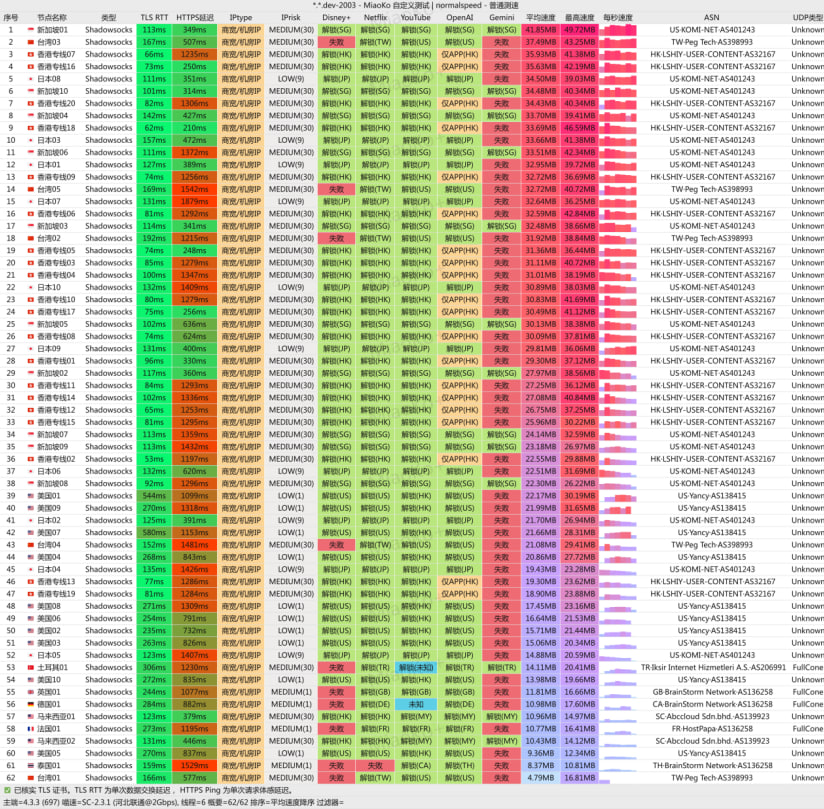
*图注 4：光速云 2026-08-19 河北联通 @2Gbps 实测报告，新加坡 01 节点平均下载速度实测达 41.85 MB/s。*

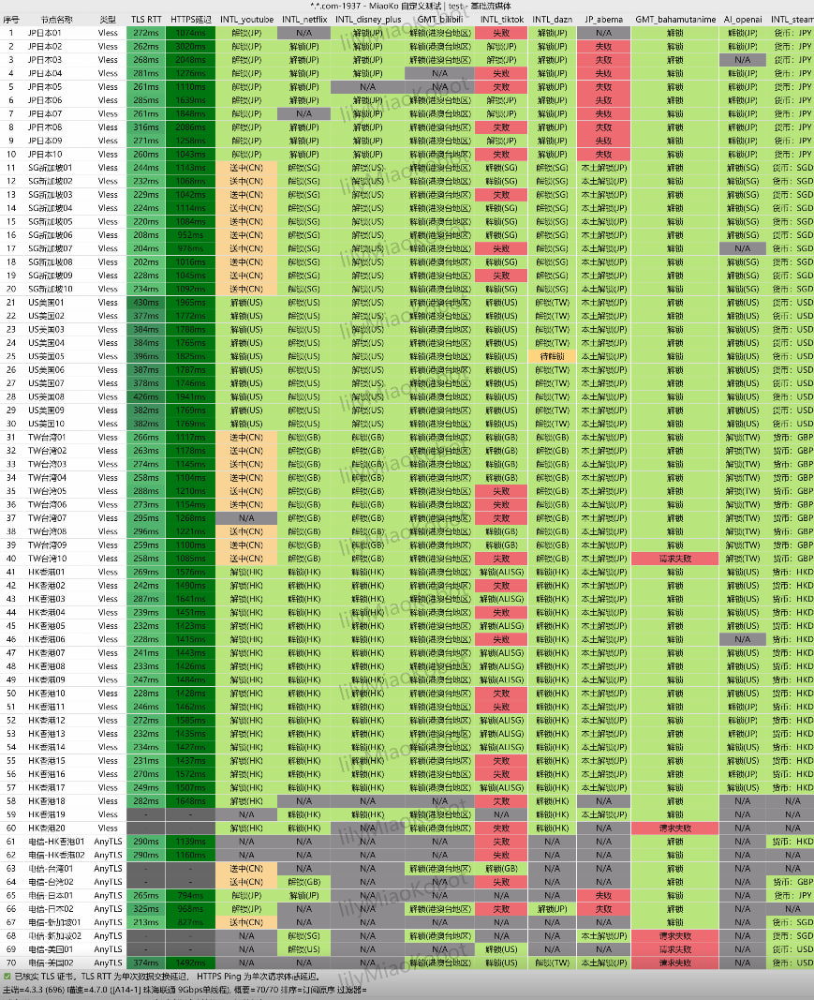
*图注 5：光速云 2026-08-19 珠海联通 9Gbps 单线程环境下 70/70 节点 VLESS / AnyTLS 协议专项测试，OpenAI ChatGPT、Steam 与主流流媒体全绿解锁。*

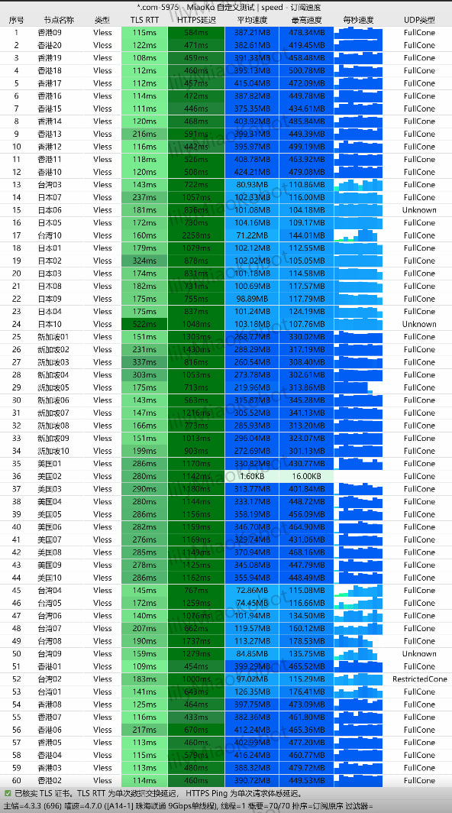
*图注 6：光速云 2026-08-19 珠海联通 9Gbps 单线程 VLESS 速度测试报告，香港节点均速达 424 MB/s，并验证支持 FullCone NAT。*

---

### 2. 暮光加速（muguang） —— BGP 智能调度与多设备专线标杆

- **成立年份**：2023 年。
- **核心特色**：主打 **BGP 智能动态调度与企业专线级出口**，覆盖 Windows、macOS、iOS、Android、Linux 全平台，支持多设备同时在线，提供 7×24 小时真人客服支持。
- **套餐规格明细**：
  - **暮光·基础版**：20元/月（**120GB/月**），性价比月付主力；
  - **暮光·标准版**：40元/月（**240GB/月**）；
  - **暮光·年付轻量版**：109元/年（折合约 9 元/月，70GB/月）；
  - **不限时流量包**：219元 150GB / 529元 400GB 一次性付费不过期。
- **实测表现**：香港节点延迟低至 26ms，下载达 509Mbps；新加坡 43ms，下载 419Mbps。
- **解锁支持**：ChatGPT、Claude、Netflix、Disney+、YouTube、HBO Max、TikTok 均表现良好。
- 👉 **[点击直达暮光加速官方注册通道 ↗](https://varnexa.twilightaff.com/#/?code=D1LHglg3)** (优惠码：`muguang5555`)

#### 📊 暮光加速节点测速图
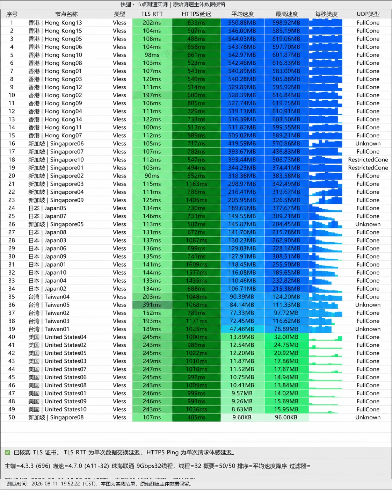
*图注：暮光加速珠海联通实测测速截图（香港 26ms / 509Mbps、新加坡 43ms / 419Mbps），亚洲近端节点延迟普遍低于 50ms。测试结果仅反映测试当次网络环境。*

---

### 3. 飞猫云（feimao） —— 年付 7 元档轻量 IEPL 专线与免配置客户端

飞猫云（feimao）自 2023 年上线运营，定位轻快省事的新手友好型机场，主打专属客户端下载登录即用（同时兼容通用订阅），年付折合约 **7 元/月 (50GB/月)**，适合不希望手动配置 Clash 订阅链接的入门及备用用户。

- **成立年份**：2023 年。
- **使用方式**：提供官方专属客户端下载登录即用，免去繁琐订阅转换流程（品牌资料说明）。
- **套餐规格**：学生版 84元/年 (50GB/月)、星耀版 25元/月 (150GB/月)、星环版 45元/月 (300GB/月)、银河版 85元/月 (600GB/月)、宇宙版 150元/月 (1000GB/月)，另有 1000GB/680元 一次性不限时流量包。
- **非晚高峰基准参考（2026-10-19 原文标注）**：香港 21ms / 526Mbps、台湾 41ms / 116Mbps、新加坡 45ms / 413Mbps、日本 54ms / 138Mbps。
- 👉 **[点击直达飞猫云官方注册通道 ↗](https://guangs.flycataff.com/#/?code=6uq0Xe9y)** (优惠码：`flycat888` 享 8 折｜含推广链接，不影响用户支付价格)

#### 📊 飞猫云节点测速实测图
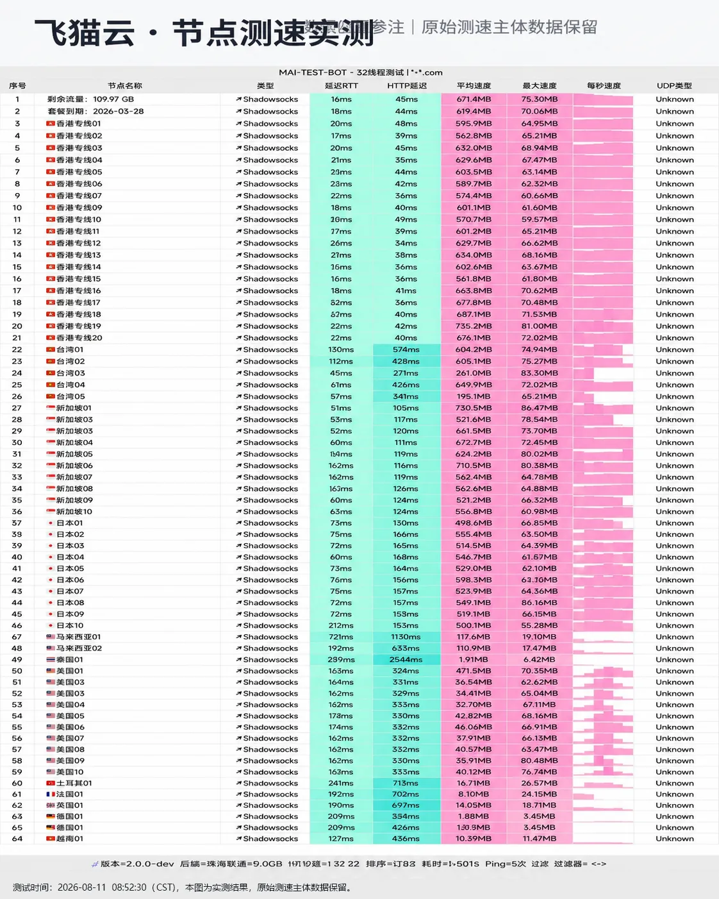
*图注：飞猫云节点测速截图。测试时间：2026-08-11 08:52:30（CST）；测速工具：MAI-TEST-BOT 2.0.0-dev（协议显示 Shadowsocks）。仅反映测试时间点单日测速表现，不代表 AI/流媒体全天候可用性。*

---

### 4. 微风网络（weifeng） —— 平价稳定 IEPL 专线与 VLESS 入门标杆

微风网络（weifeng）成立于 2023 年，采用 **IEPL 专线 + VLESS 协议** 架构，以入门高性价比（年付小包折合约 7 元/月起，清风年付 137元 含 100GB/月）与 7×24 小时客服响应为特色，面向学术检索、外贸沟通及日常 AI 工具使用群体。

- **成立年份**：2023 年。
- **核心套餐**：清风年付 137元 (100GB/月)、乘风月付 27元 (200GB/月)、破风月付 57元 (500GB/月)、御风月付 127元 (1200GB/月)，另有信风 200元/270GB、长风 370元/570GB 不限时流量包。
- **优惠活动**：购买季付及以上套餐输入优惠码 `flat888` 享 **9 折优惠**。
- **非晚高峰基准参考（2026-10-19 原文标注）**：香港 25ms / 546Mbps、台湾 40ms / 115Mbps、新加坡 43ms / 384Mbps、日本 54ms / 131Mbps。
- 👉 **[点击直达微风网络官方注册通道 ↗](https://edp01.breezenetaff.com/#/?code=t3huofyI)** (优惠码：`flat888`｜含推广链接，不影响用户支付价格)

#### 📊 微风网络节点测速图
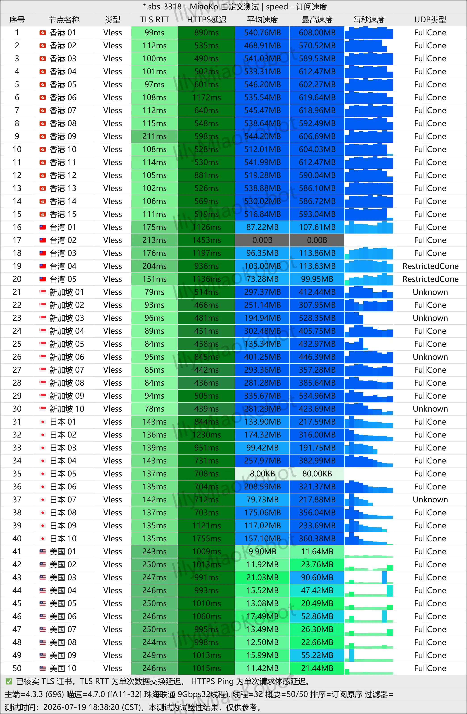
*图注：微风网络节点测速实测截图。仅反映对应测试环境与单次时段速率表现，晚高峰表现建议月付实测确认。*

---

### 5. 大佬云（dalaoyun） —— 5.6 元档极限平价 IEPL + VLESS 专线

大佬云（dalaoyun）成立于 2024 年，是 5.6 元/月（60GB/月 年付口径）极限平价 IEPL 梯队的核心代表之一，支持 VLESS 协议、自研客户端与 Clash / Shadowrocket 第三方订阅导入，季付及以上可享 7 折优惠。

- **成立年份**：2024 年。
- **核心定位**：**年付折合约 5.6 元/月 (60GB/月)**，采用 **IEPL 专线 + VLESS 协议**，兼容官方客户端与通用订阅导入（品牌资料核验 `dataStatus: vendor`）。
- **适合人群**：预算极度敏感、日常主要用于查阅资料与轻度社媒交流的学生及备用用户。
- 👉 **[点击直达大佬云官方注册通道 ↗](https://qwerty.dalaoyunaff.com/#/?code=jCPLmoWN)** (优惠码：`dly888`｜含推广链接，不影响用户支付价格)

---

### 6. 星岛梦（xingdaomeng） —— 2020老牌 IEPL 与永久不限时流量包

星岛梦（xingdaomeng）自 2020 年稳定运营，品牌资料显示其采用 IEPL 专线与 Trojan 协议，全节点 1 倍流量且不限设备连接数，提供 96 元/年（60GB/月）年付小包及多档不限时流量包，适合多设备家庭及长周期备用需求。

- **成立年份**：2020 年。
- **套餐明细**：贴心小包 96元/年 (60GB/月)、超量 25元/月 (150GB)、进阶 50元/月 (300GB)、闪光 70元/月 (500GB)、旗舰 130元/月 (1000GB)；另有 100GB (100元) / 300GB (300元) / 1TB (600元) 永久不限时包。
- **优惠活动**：新人注册输入优惠码 `nmw888` 享 **9 折特惠**。
- 👉 **[点击直达星岛梦官方注册通道 ↗](https://guangs.xingdaomeng.com/#/?code=1TynBYnR)** (优惠码：`nmw888`｜含推广链接，不影响用户支付价格)

#### 📊 星岛梦节点测速实测图
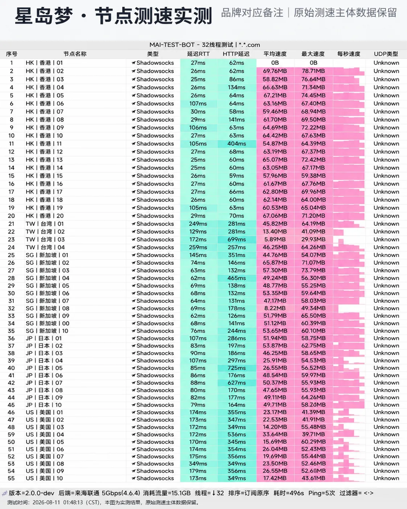
*图注：星岛梦节点测速实测截图。测试时间：2026-08-11 01:48:13（CST）；测速工具：MAI-TEST-BOT 2.0.0-dev（协议显示 Shadowsocks）。单日快照不代表全天带宽恒定值。*

---

### 7. 隐形人（yinxingren） —— 企业级 IPLC 专线直连与专属客户端模式

隐形人（yinxingren）自 2024 年起运营，品牌资料显示采用企业级 IPLC 专线直连架构与 60+ 节点布局，采用全平台专属客户端一键连接模式（不提供第三方订阅链接）。

- **成立年份**：2024 年。
- **品牌资料重点 (`dataStatus: vendor`)**：品牌资料显示其官方承诺 1 小时故障修复响应、主打全平台专属客户端（不支持 Clash / Shadowrocket 等第三方订阅导入），月付白银纪元 24元 (144GB/月) 起，星耀风暴年付 109元 (80GB/月)，另有 160GB (229元) / 420GB (549元) / 1TB (1199元) 一次性不限时流量包。
- **解锁标注**：品牌资料标注支持 ChatGPT、Netflix、Disney+、YouTube、HBO Max 与 Spotify；Claude / Gemini / TikTok 视节点而定。
- 👉 **[点击直达隐形人官方注册通道 ↗](https://yinxingren1.invisibleaff.com/#/?code=kcyEeoJT)** (优惠码：`yxr888` / 历史折扣码 `moon80` 8折｜含推广链接，不影响用户支付价格)

---

### 8. 二猫云（ermao） —— 20元档 130GB IEPL + VLESS 长期主力方案

二猫云（ermao）成立于 2023 年，品牌资料显示其全线部署 **IEPL 专线 + VLESS 协议**，不限账号设备连接数并配备独家定制客户端，定位长期稳定运营，适合高频观看 YouTube 4K、Netflix 与日常跨境办公。

- **核心套餐**：二猫年付小包 89元/年 (60GB/月)、白猫套餐 20元/月 (130GB/月)、橘猫畅玩版 40元/月 (230GB/月)、牛奶猫 80元/月 (430GB/月)、黑猫 160元/月 (850GB/月)，另有 99元 100GB 一次性不限时包。
- **节点提醒**：节点以香港、台湾、日本、美国核心枢纽为主（无独立新加坡高配主节点时建议先确认目标地区需求）。
- 👉 **[点击直达二猫云官方注册通道 ↗](https://guangs.2maoyunaff.cc/#/?code=7mjvgGbW)** (优惠码：`ermao5555`｜含推广链接，不影响用户支付价格)

#### 📊 二猫云节点测速实测图
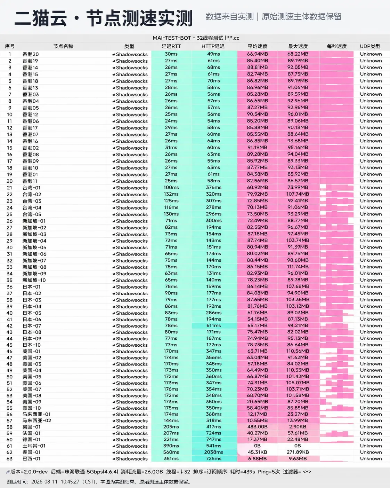
*图注：二猫云节点测速实测截图。测试时间：2026-08-11 10:45:27（CST）；测速工具：MAI-TEST-BOT 2.0.0-dev（协议显示 Shadowsocks）。测试结果仅代表测速时间点单日环境。*

---

### 9. 无忧链接（wuyou） —— 免转换订阅与 6 元轻量跨境电商专线

无忧链接（wuyou）自 2025 年运营，主打轻度用户与跨境电商 TikTok 跨区直连场景，全线节点无倍率、不限速且不限设备数量，同时提供 79元/年 MINI 轻量档（约 6.5元/月起）及通用免转换订阅/专属客户端支持。

- **套餐明细**：MINI链接 年付 79元 (40GB/月)、舒心链接 19元/月 (100GB)、省心 33元/月 (200GB)、随心 77元/月 (500GB)、忘忧 117元/月 (1000GB)；永久不限时包 100GB (108元) / 300GB (298元)。
- **优惠活动**：输入优惠码 `wuyou666` 享官方折扣。
- 👉 **[点击直达无忧链接官方注册通道 ↗](https://wep01.worryfreeaff.com/#/?code=4ZoSbLdL)** (优惠码：`wuyou666`｜含推广链接，不影响用户支付价格)

#### 📊 无忧链接真实节点测速与御三家流媒体全绿解锁实测
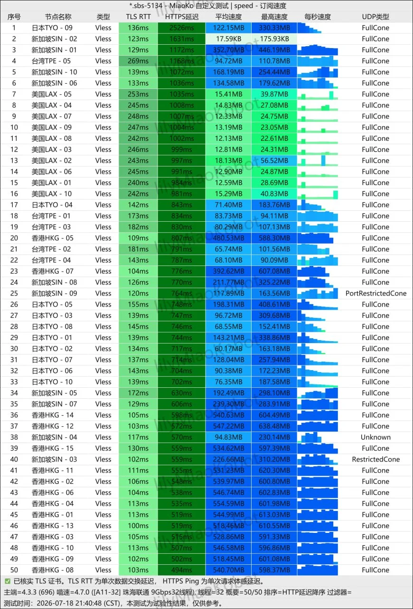
*图注 1：无忧链接节点测速实测报告（2026-07-18 21:40:48 CST 晚高峰时段，珠海联通 9Gbps 32 线程环境，50/50 节点均通并支持 FullCone）。*

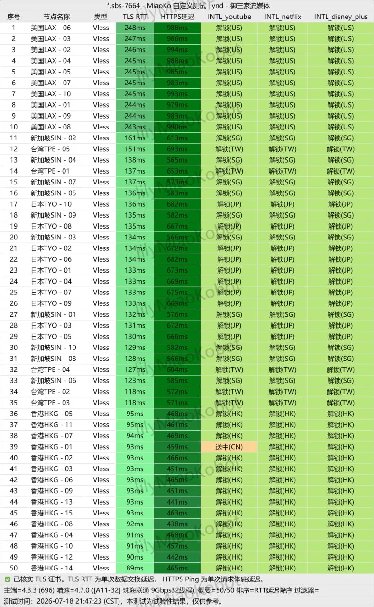
*图注 2：无忧链接御三家流媒体解锁实测报告（2026-07-18 21:47:23 CST 实测，YouTube / Netflix / Disney+ 主流港区及亚太节点全绿通过）。*

---

### 10. 唯兔云（weitu） —— 60+ 节点 IPLC 专线与多端全协议负载均衡

唯兔云（weitu）自 2023 年运营至今，品牌资料显示其部署 IPLC 专线与 Trojan/VLESS 多协议自适应，拥有超过 60 个全球节点及三网智能负载均衡，1 倍流量、不限速且不限设备同时在线。

- **套餐明细**：年付版限量款 79.9元/年 (45GB/月)、年付加强专线 120元/年 (75GB/月)、节假日限时 14.9元/月 (100GB)、普通版 19.9元/月 (150GB)、进阶版 29.9元/月 (200GB)、专业版 59.9元/月 (500GB)、至尊版 119.9元/月 (1000GB)；不限时包 100GB (100元) / 200GB (160元) / 500GB (340元)。
- **优惠活动**：使用优惠码 `weitu666` 享 9 折优惠。
- 👉 **[点击直达唯兔云官方注册通道 ↗](https://guangs.v2yunvipaff.com/#/?code=xIutqOBA)** (优惠码：`weitu666` 享 9 折｜含推广链接，不影响用户支付价格)

#### 📊 唯兔云节点测速实测图
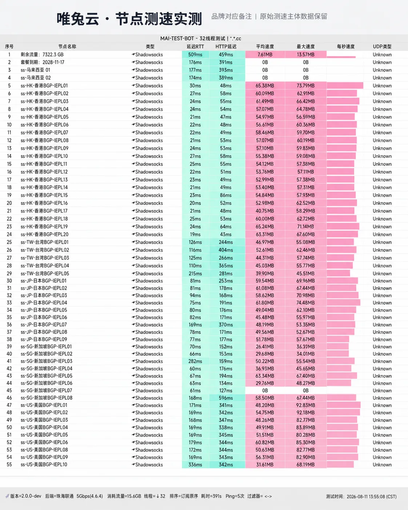
*图注：唯兔云节点测速实测截图。测试时间：2026-08-11 13:55:08（CST）；测速工具：MAI-TEST-BOT 2.0.0-dev（协议显示 Shadowsocks）。仅反映单次环境实测。*

---

### 11. Firefly（firefly） —— 全专线 IPLC + VLESS 与抗封锁官方直连架构

Firefly 萤火虫采用全专线 IPLC 结合 VLESS 协议原生 IP 架构，品牌资料显示其支持抗封锁直连访问官网并提供 6 档完整套餐周期，官方客户端下载登录即用、不限设备数量，并与微风/飞鸟存在同系技术溯源关系。

- **套餐明细 (`dataStatus: vendor`)**：年付版 96元/年 (60GB/月，折合 8元/月)、Firefly Lite 25元/月 (150GB)、Plus 45元/月 (300GB)、Blaze 85元/月 (600GB)、Nova 150元/月 (1000GB)、不限时包 100元/100GB；资料标注新用户优惠码 `firefly` 享 8 折（年付版不适用）。
- **基准速度参考（2026-10-19 原文标注）**：香港 27ms / 547Mbps、台湾 39ms / 135Mbps、新加坡 42ms / 445Mbps、日本 57ms / 147Mbps、美国 143ms / 30Mbps。
- 👉 **[点击直达 Firefly 官方注册通道 ↗](https://vip02.fireflyaff.com/#/?code=2n7VURre)** (优惠码：`firefly`｜含推广链接，不影响用户支付价格)

---

## 二、第二梯队：实测测速图精选大厂梯队（11 家实测图公开）

本梯队品牌均具备本站保存的原始单日节点测速截图（来自 2026-08-11 CST 实测批次）。以下严格区分「单日测速截图 (`measured`)」与「品牌方资料及非晚高峰基准 (`vendor`)」，供读者按预算、协议与客户端支持方式客观比选：

### 12. 宇宙云（yuzhou） —— 14.9元档 VLESS + 三网智能负载均衡
宇宙云（yuzhou）早期品牌资料标注其采用 **VLESS 协议** 与三网优化线路，配置 60+ 节点及智能负载均衡调度，主打 ¥96/年起年付入门方案及 ¥14.9/月 100GB 月付套餐。
- **使用方式与优惠 (`dataStatus: vendor`)**：具体客户端与订阅支持范围待官网核实；资料记录优惠码 `YUZHOU553`（历史资料称新用户 8 折）。
- **资料局限提醒**：当前公开资料尚未收录宇宙云最新全档位月付价格表与独立解锁测试矩阵，下单前建议以官网套餐面板实时展示为准。
- 👉 **[进入宇宙云官方注册通道 ↗](https://wzjc.yuzoucloud.cc/#/?code=yrThwMP1)** (优惠码：`YUZHOU553`｜含推广链接，不影响用户支付价格)
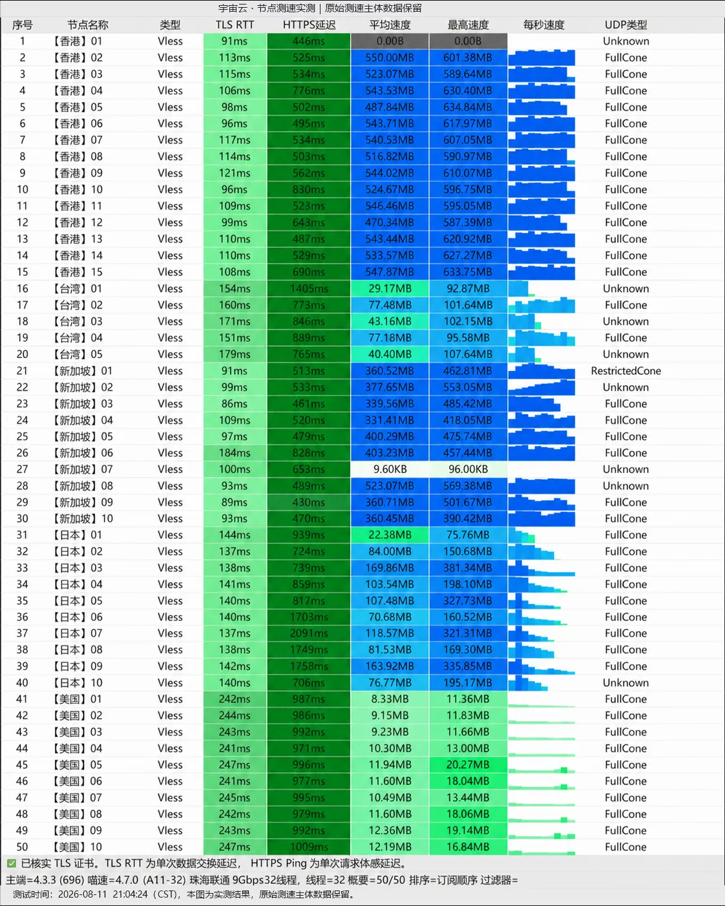
*图注：宇宙云节点测速实测截图。测试时间：2026-08-11 21:04:24（CST，晚高峰时段）；测速工具：main 4.3.3 (696) / miaosu 4.7.0 (A11-32)（协议显示 VLESS）。注：仅反映当次单日测速表现，未单独测试流媒体/AI 全天候解锁。*

---

### 13. U1S1（u1s1） —— 20元档 IPLC 专线与 2000Mbps 带宽定位
U1S1（u1s1）是 2025 年起上线运营的 **IPLC 专线** 品牌，官方资料标注最高 2000Mbps 带宽、晚高峰不限速且不限设备同时连接，重点面向需要高速下载与多设备同时在线的用户。
- **套餐明细 (`dataStatus: vendor`)**：就是好用包 年付 ¥96 (60GB/月)、普通人真够了包 月付 ¥20 (120GB/月)、你以为用不到包 月付 ¥40 (300GB/月)、瘾大就拉满包 月付 ¥100 (700GB/月)、我全都要包 月付 ¥180 (1500GB/月)。
- **非晚高峰基准参考（2026-10-19 原文标注）**：香港 24ms / 538Mbps、台湾 39ms / 107Mbps、新加坡 46ms / 414Mbps、日本 57ms / 133Mbps、美国 134ms / 20Mbps；官方资料标注支持 ChatGPT、Claude、Netflix、Disney+、YouTube、HBO Max、TikTok 与 Spotify。
- **选购提示**：U1S1 上线周期较短，建议先通过 20 元月付档实测晚高峰体感后再决定是否续费长周期。
- 👉 **[进入 U1S1 官方注册通道 ↗](https://guangs.vipaff.cc/#/?code=xhX5X22f)** (优惠码：`akaka`｜含推广链接，不影响用户支付价格)
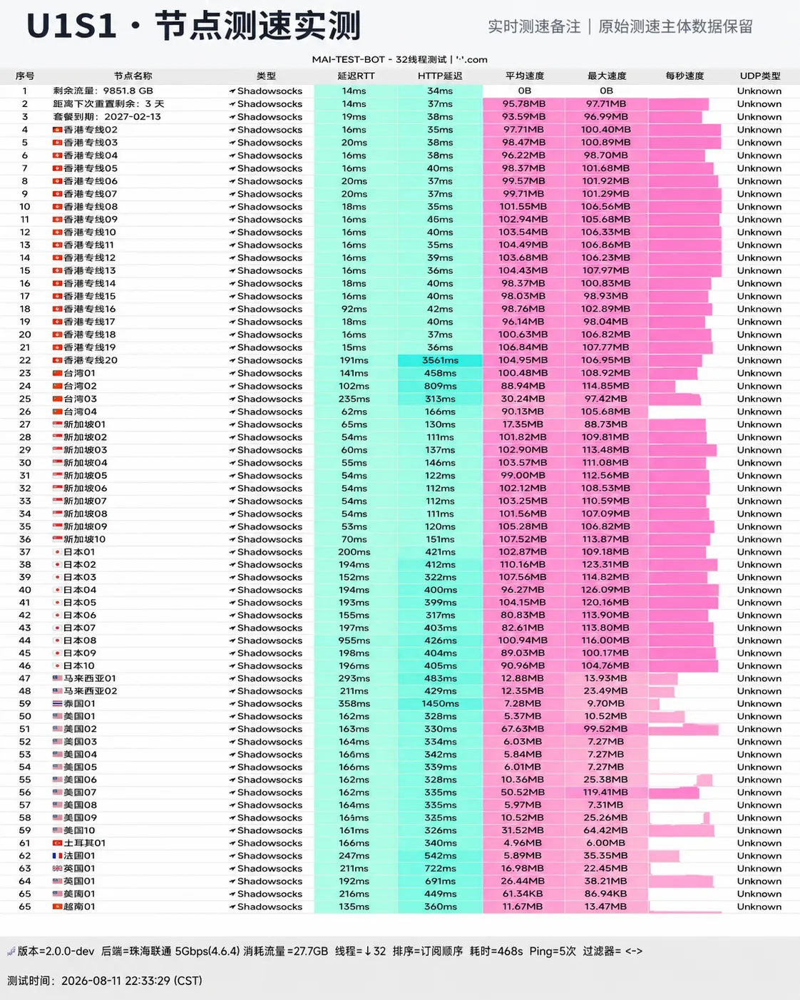
*图注：U1S1 节点测速实测截图。测试时间：2026-08-11 22:33:29（CST）；测速工具：MAI-TEST-BOT 2.0.0-dev（协议显示 Shadowsocks）。单日快照不构成跨运营商长期稳定性承诺。*

---

### 14. 灵猫网络（lingmao） —— 专属客户端免配置与 1 倍流量多端不限速
灵猫网络（lingmao）自 2025 年起运营，主打 **1 倍流量计费、不限速且不限设备同时使用**，提供香港、台湾、日本、新加坡、美国节点；2026 年 10 月起全面转为**专属客户端**下载登录即用模式（不提供第三方订阅链接）。
- **套餐明细 (`dataStatus: vendor`)**：年付小包 ¥85 (45GB/月，折约 ¥7.1/月起)、月付 Small ¥25 (150GB/月)、月付 Big ¥45 (300GB/月)、季付 Big ¥125 (300GB/月)、年付 Small ¥195 (150GB/月)、年付 Big ¥295 (300GB/月)。优惠码 `lmao888`（资料另列 `lingmao` 8折，年付小包不适用）。
- **非晚高峰基准参考（2026-10-19 原文标注）**：香港 22ms / 492Mbps、台湾 40ms / 109Mbps、新加坡 46ms / 409Mbps、日本 57ms / 147Mbps、美国 164ms / 19Mbps。
- 👉 **[进入灵猫网络官方注册通道 ↗](https://vip01.civetnet.com/#/?code=8MIAyxak)** (优惠码：`lmao888`｜含推广链接，不影响用户支付价格)
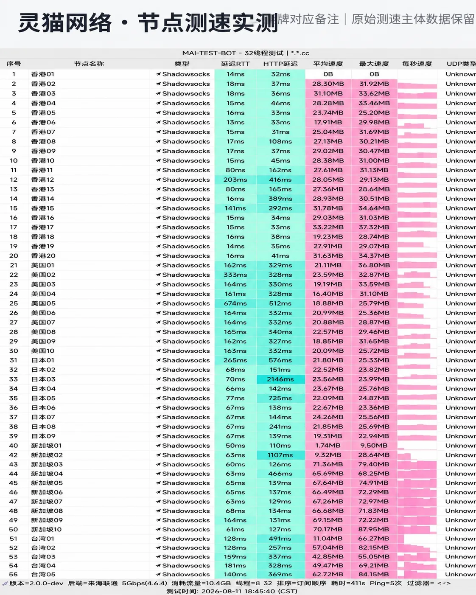
*图注：灵猫网络节点测速实测截图。测试时间：2026-08-11 18:45:40（CST）；测速工具：MAI-TEST-BOT 2.0.0-dev（协议显示 Shadowsocks）。注意：需使用官方专属客户端登录，不支持导入第三方 Clash 订阅。*

---

### 15. 极连云（jilian） —— 18元 100GB IEPL 专线与 AI 工具场景调优
极连云（jilian）自 2024 年起运营，品牌资料明确说明采用 **IEPL 专线**，主力入门月付为 **18 元/月含 100GB/月**，同时支持自研客户端与第三方客户端订阅导入，明确面向常见 AI 工具及日常网页检索场景优化。
- **与同价位差异**：同处 18 元月付档的极连云（100GB）与光年梯（110GB）架构相近，极连云运营年份略早于 2025 年上线的光年梯，适合侧重 AI 对话与稳定日常检索的用户。
- 👉 **[进入极连云官方注册通道 ↗](https://guangs.jlyvipaff.com/#/?code=VM1rKGUu)** (优惠码：`ji8888`｜含推广链接，不影响用户支付价格)
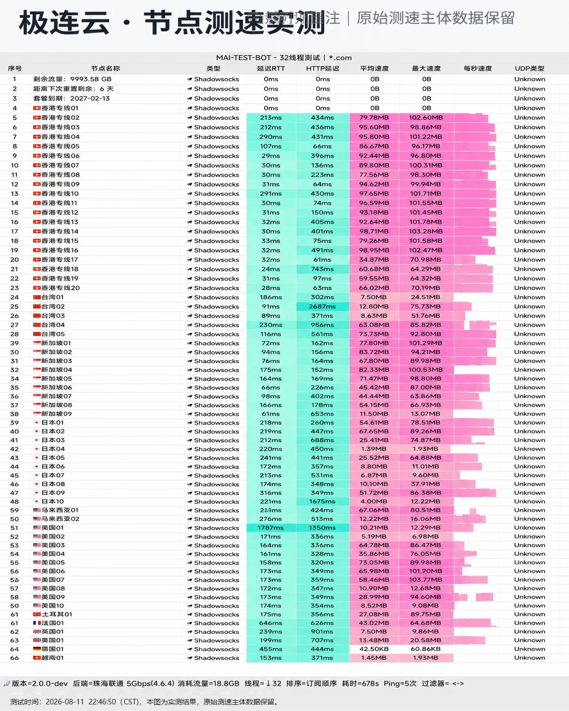
*图注：极连云节点测速实测截图。测试时间：2026-08-11 22:46:50（CST）；测速工具：MAI-TEST-BOT 2.0.0-dev（协议显示 Shadowsocks）。仅反映测试时间点单日测速表现。*

---

### 16. 光年梯（guangnian） —— 18元 110GB IEPL + VLESS 专线
光年梯（guangnian）是 2025 年上线的新生代 **IEPL + VLESS** 专线品牌，同样定位 **18 元/月** 价格带但给到 **110GB/月** 流量（较同档极连云多 10GB），支持自研多端客户端与第三方订阅导入。
- **产品定位 (`dataStatus: vendor`)**：品牌资料将其定位于低价中转与高价旗舰专线之间的折中档位，覆盖常见 AI 工具与主流流媒体场景；鉴于品牌成立时间较短，建议优先月付验证本地网络表现。
- 👉 **[进入光年梯官方注册通道 ↗](https://guangs.gntaff.com/#/?code=X1FoxjGE)** (优惠码：`gnt6666`｜含推广链接，不影响用户支付价格)
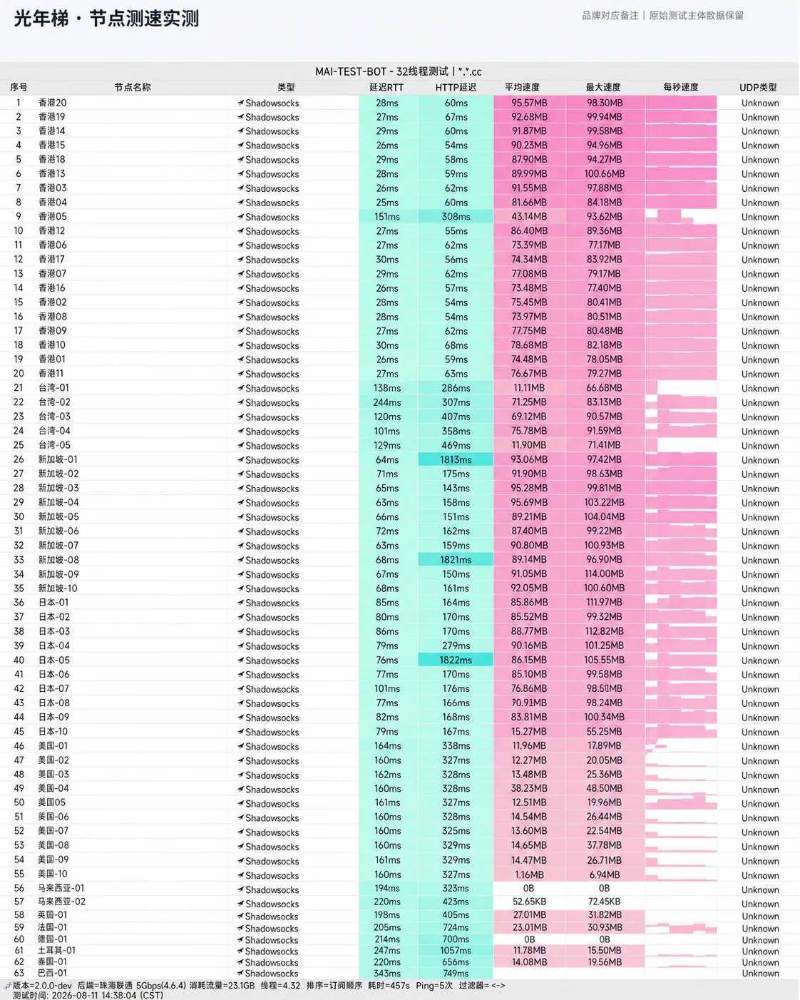
*图注：光年梯节点测速实测截图。测试时间：2026-08-11 14:38:04（CST）；测速工具：MAI-TEST-BOT 2.0.0-dev（协议显示 Shadowsocks）。仅反映单次快照，不直接证明全天候稳定性。*

---

### 17. 一翻云（yifan） —— 全节点 IEPL 物理专线与三协议多端兼容
一翻云（yifan）自 2025 年起运营，品牌资料显示其全节点采用 **IEPL 物理专线搭配原生住宅 IP**，开放 **Hysteria 2 / VLESS-Reality / Shadowsocks** 三协议兼容且不限速、不限设备数量，同时提供永久不过期的一次性流量包。
- **套餐明细 (`dataStatus: vendor`)**：年付小包 ¥98 (60GB/月)、轻享版 ¥20/月 (150GB)、舒享版 ¥35/月 (350GB)、尊享版 ¥55/月 (600GB)、极致版 ¥95/月 (1.2TB)；另有不限时包 100GB (¥100) / 250GB (¥200) / 500GB (¥400)。注意官网未提供免费试用。
- **非晚高峰基准参考（2026-10-19 原文标注）**：香港 23ms / 477Mbps、台湾 40ms / 117Mbps、新加坡 42ms / 390Mbps、日本 53ms / 136Mbps、美国 180ms / 20Mbps。
- 👉 **[进入一翻云官方注册通道 ↗](https://guangs.1flyunaff.cc/#/register?code=Yr7FhB7r)** (优惠码：`yfy6666` / `1FLYYUN` 9折｜含推广链接，不影响用户支付价格)
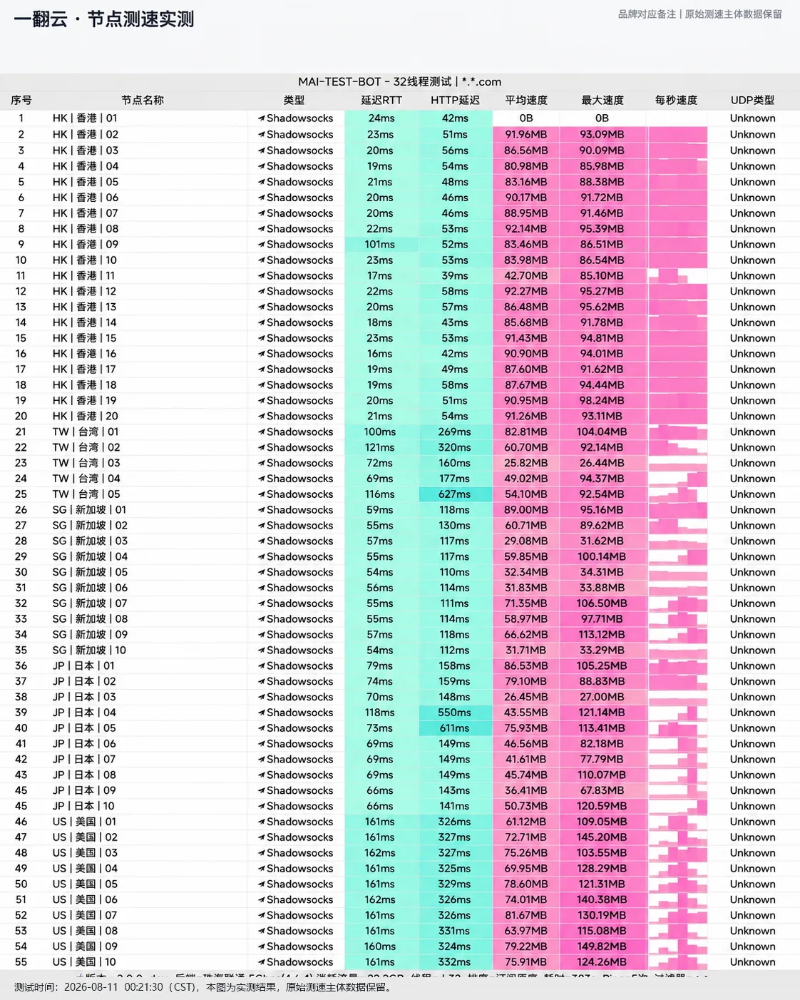
*图注：一翻云节点测速实测截图。测试时间：2026-08-11 00:21:30（CST）；测速工具：MAI-TEST-BOT 2.0.0-dev（协议显示 Shadowsocks）。仅代表当次测试网络条件下的实测截图。*

---

### 18. SOGO 云（sogo） —— 15 国节点覆盖 IEPL + 三网 BGP 优化（仅专属客户端）
SOGO 云由海外团队运营，全线接入 **IEPL 专线与三网 BGP 优化**（VLESS 协议），最大亮点是节点覆盖香港、台湾、日本、新加坡、美国、韩国等 **15 个国家和地区**，覆盖面在同批品牌中较为突出。
- **关键使用限制 (`dataStatus: vendor`)**：SOGO 云**不提供第三方订阅链接**，无法导入 Clash 或 Shadowrocket，仅可通过官方自研客户端登录使用（覆盖 Windows / macOS / iOS / Android 及主流软路由）。
- **套餐与优惠**：小包年付版 ¥98/年 (60GB/月)、基础版 ¥25/月 (150GB)、优选版 ¥45/月 (350GB)、强化版 ¥80/月 (550GB)、顶配版 ¥150/月 (1.1TB)，另有 120GB (¥120) 至 1TB (¥850) 不限时套餐。优惠码 `sss777` / `SOGO10000` (9折)。
- 👉 **[进入 SOGO 云官方注册通道 ↗](https://guangs.sogoyunaff.cc/#/?code=327Vs0w7)** (优惠码：`sss777`｜含推广链接，不影响用户支付价格)
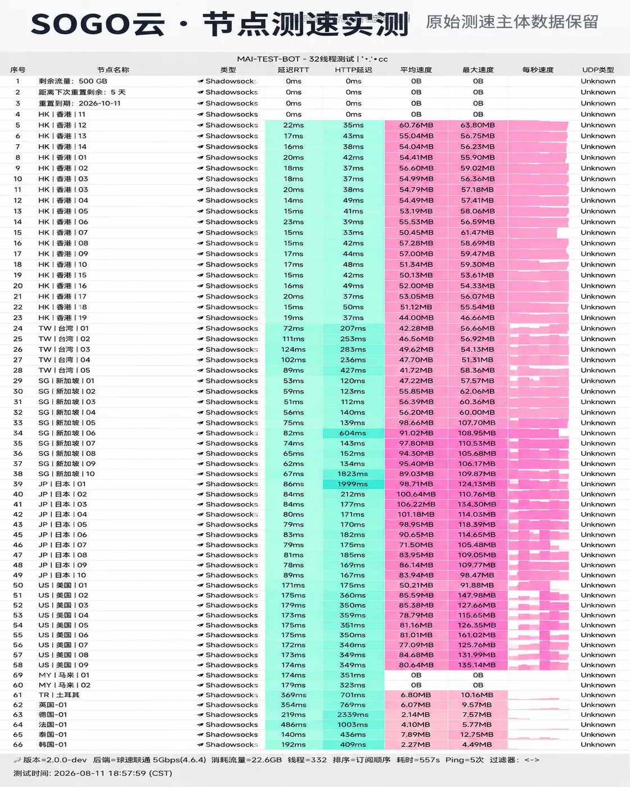
*图注：SOGO 云节点测速实测截图。测试时间：2026-08-11 18:57:59（CST）；测速工具：MAI-TEST-BOT 2.0.0-dev（协议显示 Shadowsocks）。仅反映当次单日测速表现。*

---

### 19. 可信云（kexin） —— 25元 150GB IEPL + VLESS 高透明度专线
可信云（kexin）自 2024 年起运营，采用 **IEPL 专线 + VLESS 协议**，基础月付 **25 元含 150GB/月**，支持第三方客户端导入，特色是在官方资料中明确标注“AI 与流媒体目前缺乏统一实测数据”，不做夸大解锁承诺。
- **与同价位对比**：规格与 SOGO 云、速界接近，但开放第三方客户端订阅且品牌信息披露克制客观，适合偏好自行导入 Clash / Sing-box 进行规则分流的理性用户。
- 👉 **[进入可信云官方注册通道 ↗](https://guangs.kosingaff.com/#/register?code=UYDtNlCY)** (优惠码：`kkk333`｜含推广链接，不影响用户支付价格)
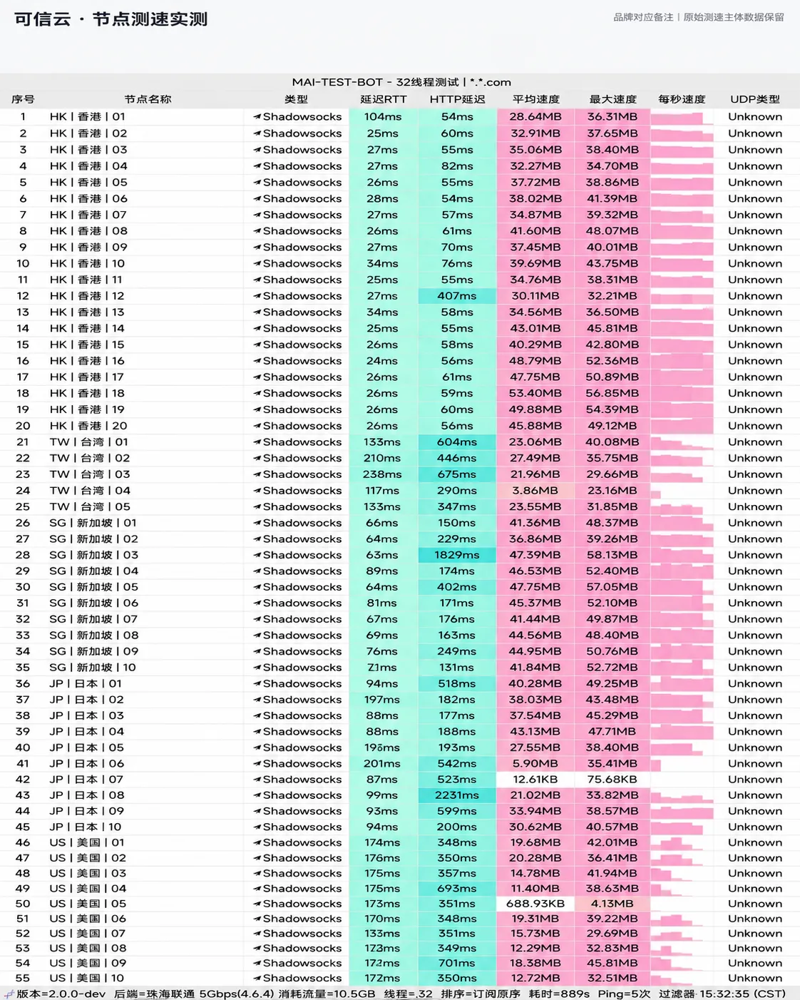
*图注：可信云节点测速实测截图。测试时间：2026-08-11 15:32:35（CST，日历日期按同批次时间印记推算，待与原始记录核对）；测速工具：MAI-TEST-BOT 2.0.0-dev（协议显示 Shadowsocks）。*

---

### 20. 速界（sujie） —— 25元 150GB 主打 ChatGPT / Claude / Gemini 场景优化
速界（sujie）自 2024 年起运营，定位 25 元/月 150GB 档位的 **IEPL + VLESS 专线**，同时支持自研客户端与第三方订阅导入；在同批 25 元档品牌中，速界是明确重点强调 ChatGPT、Claude 与 Gemini 生产环境访问场景的一家。
- **客观披露 (`dataStatus: vendor`)**：速界品牌资料同时说明 AI 可用性受落地 IP、地区及平台实时风控规则影响，不承诺永久稳定支持所有 AI 平台；结合规则分流切换到高纯净度节点效果更佳。
- 👉 **[进入速界官方注册通道 ↗](https://guangs.speedworldaff.cc/#/register?code=xgXzEfZB)** (优惠码：`sss1111`｜含推广链接，不影响用户支付价格)
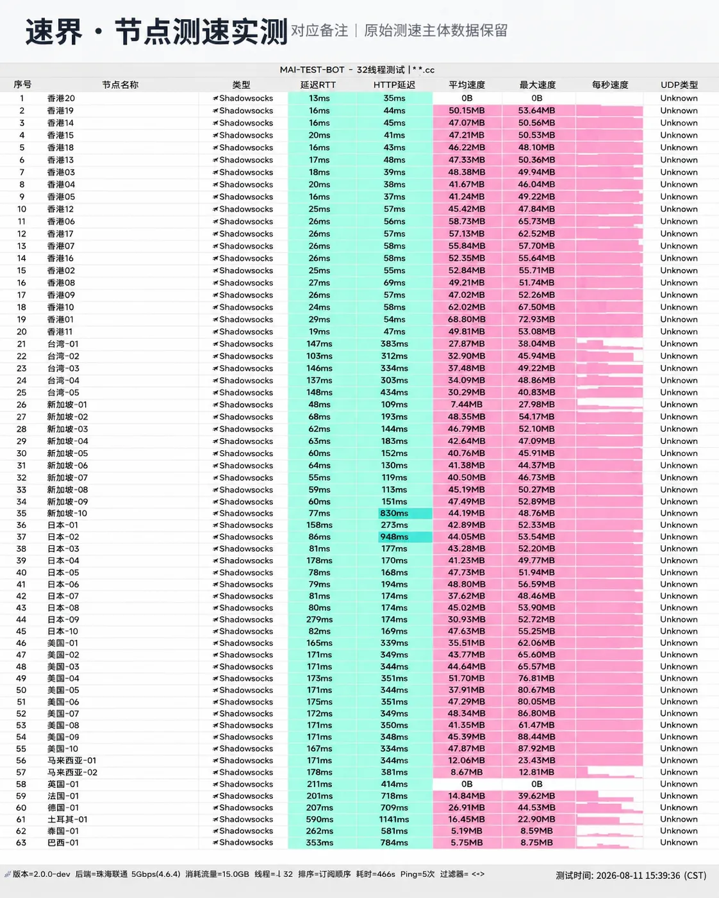
*图注：速界节点测速实测截图。测试时间：2026-08-11 15:39:36（CST）；测速工具：MAI-TEST-BOT 2.0.0-dev（协议显示 Shadowsocks）。该截图仅记录节点带宽速率，未单独包含流媒体/AI 解锁检验。*

---

### 21. 快狸（kuaili） —— 25元 150GB VLESS 协议实测代表
快狸（kuaili）定位 **25 元/月 150GB** 高性能跨境专线网络，在 2026-08-11 测速批次中直接采用 VLESS 协议与新版喵速测速内核完成测试，适合关注 VLESS 原生低开销加密与多设备同时在线的用户。
- **使用提示**：因当前归档中的商业详情较少，建议先选择最低月付套餐实际体验节点归属地与本地宽带匹配度。
- 👉 **[进入快狸官方注册通道 ↗](https://guangs.kuailicloud.cc/#/register?code=AiqyM8oG)** (优惠码：`kkk2222`｜含推广链接，不影响用户支付价格)
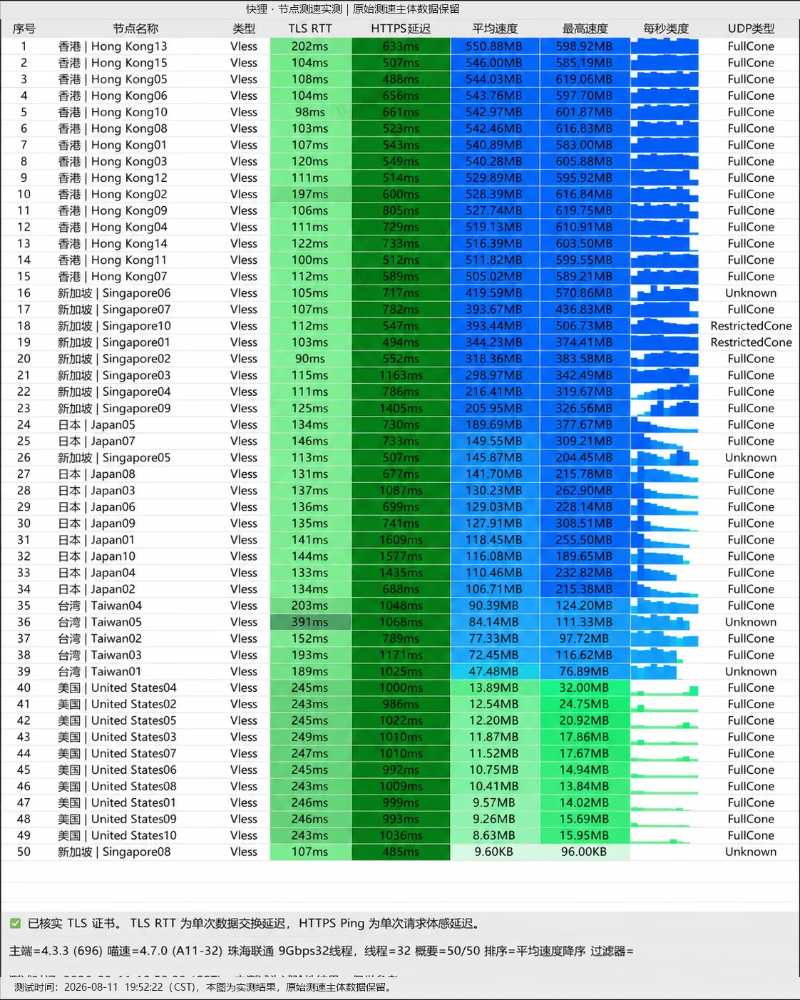
*图注：快狸节点测速实测截图。测试时间：2026-08-11 19:52:22（CST）；测速工具：main 4.3.3 (696) / miaosu 4.7.0 (A11-32)（协议显示 VLESS）。注：单日测速快照不等于全天候无限速保证。*

---

### 22. 全球云（quanqiu） —— 60+ 节点 Trojan/SS 专线（仅专属客户端）
全球云（quanqiu）主打 **IPLC / IEPL 专线中转** 结合 **Trojan / Shadowsocks** 双协议与 2Gbps+ 带宽资源，覆盖全球 **60+ 节点**，提供多档不限时流量包与月付/年付方案，采用专属客户端登录即用模式（不提供第三方订阅）。
- **套餐明细 (`dataStatus: vendor`)**：轻量版年付 ¥99 (59GB/月)、入门月付 ¥20 (120GB)、进阶 ¥40 (300GB)、高端 ¥100 (700GB)、商业 ¥180 (1500GB)，另有 100GB (¥100) / 400GB (¥360) / 800GB (¥700) 不限时轻量及标准包。优惠码 `qqy7777` / 历史 `qq88` (8折)。
- **非晚高峰基准参考（2026-10-19 原文标注）**：香港 25ms / 489Mbps、台湾 37ms / 117Mbps、新加坡 45ms / 430Mbps、日本 55ms / 133Mbps、美国 138ms / 18Mbps。
- 👉 **[进入全球云官方注册通道 ↗](https://guangs.gcvipaff.com/#/?code=Ov2nvU9C)** (优惠码：`qqy7777`｜含推广链接，不影响用户支付价格)
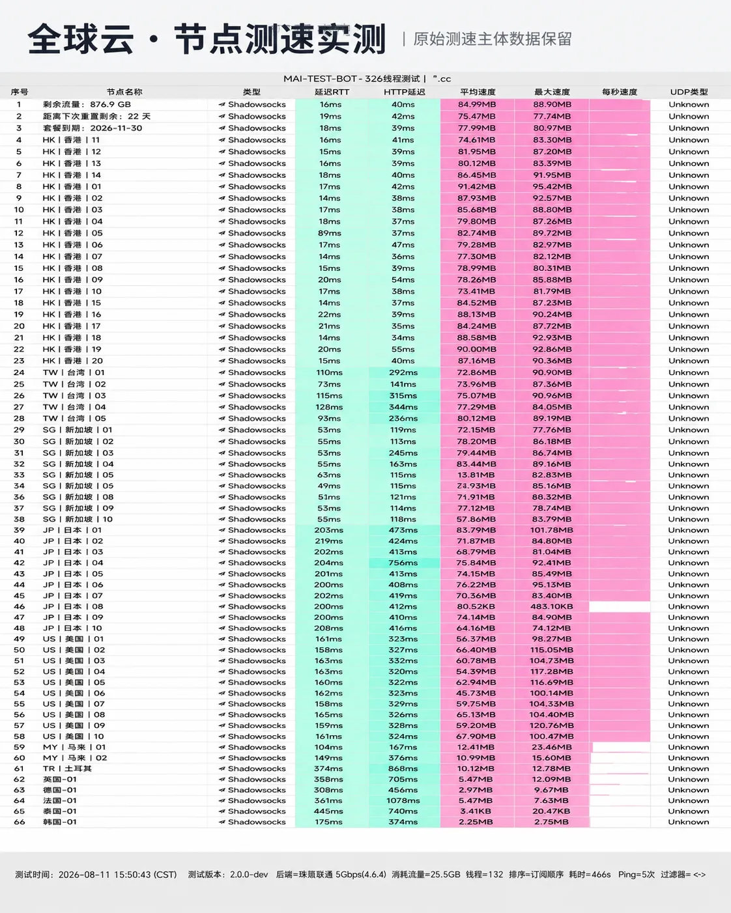
*图注：全球云节点测速实测截图。测试时间：2026-08-11 15:50:43（CST）；测速工具：MAI-TEST-BOT 2.0.0-dev（协议显示 Shadowsocks）。仅反映单次时段测试结果，不代表全平台解锁承诺。*

---

## 三、第三梯队：平价入门与多端自研机场梯队（7 家客观详评）

本梯队品牌包含高端纯 IPLC 代表 **闪跃**、**5.6 元/月** 极限平价 IEPL 四小龙（闪电鼠、云界线、榴莲云、环球梯）、14 元中间档 **神行加速** 与 **梯子云**（自研全平台 + 通用订阅双支持），均依据原始品牌资料标注呈现：

- **23. 闪跃（shanyue） —— 纯 IPLC 专线低延迟旗舰定位（¥8/月起 · 月付 ¥24/150GB）**
  闪跃定位偏高端 **纯 IPLC 专线**，年付版 ¥96 (60GB/月)、闪动月付 ¥24 (150GB)、飞跃 ¥44 (300GB)、瞬移 ¥84 (600GB)、跃迁 ¥134 (1000GB)。采用专属客户端登录即用（不提供订阅链接）；2026-10-19 非晚高峰基准记录：香港 23ms / 548Mbps、台湾 38ms / 110Mbps、新加坡 44ms / 383Mbps、日本 53ms / 144Mbps。👉 **[官网注册 ↗](https://vip02.flashleapaff.com/#/?code=3lgzm9mm)** (优惠码：`shanyue` 8折，年付不适用)
- **24. 闪电鼠（shandianshu） —— 5.6元极限平价 IEPL + VLESS 方案（60GB/月）**
  闪电鼠自 2024 年起运营，年付折约 **5.6 元/月含 60GB/月**，部署 IEPL 专线 + VLESS 协议，支持自研客户端及 Clash / 小火箭订阅导入，季付及以上可享 7 折，适合作为极低预算的入门或备用通道。👉 **[官网注册 ↗](https://qwerty.shandianshuaff.com/#/?code=rUE75iYh)** (优惠码：`sd88`)
- **25. 云界线（yunjiexian） —— 5.6元极限平价 IEPL + VLESS 方案（60GB/月）**
  云界线规格与闪电鼠、大佬云相近，提供 IEPL 专线、VLESS 协议、年付约 5.6 元/月 60GB 及自研/第三方双模式；注意其推广注册链接为 `?code=` 格式（不含 `#`），访问前请确认浏览器正常跳转。👉 **[官网注册 ↗](https://qwerty.yunjiexianaff.com/?code=HBaZ91c6)** (优惠码：`yjx888`)
- **26. 榴莲云（liulianyun） —— 5.6元极限平价 IEPL 方案（协议待补充）**
  榴莲云同属年付约 5.6 元/月（60GB/月）IEPL 专线与季付 7 折梯队，支持自研客户端与通用订阅导入，但当前品牌资料未统一明确公布其协议类型；对指定 VLESS 协议有刚需的用户可优先对比闪电鼠或大佬云。👉 **[官网注册 ↗](https://qwerty.liulianyunaff.com#/?code=hS5pvbfE)** (优惠码：`ll88`)
- **27. 神行加速（shenxing） —— 14元中间档 IEPL + VLESS 双倍流量方案（120GB/月）**
  神行加速自 2024 年起运营，年付折约 **14 元/月含 120GB/月**（流量为 5.6 元档的两倍），采用 IEPL 专线 + VLESS 协议，支持自研客户端与第三方订阅，新用户享 7 折优惠，是 5.6 元与 20 元档之间的高性价比中间选项。👉 **[官网注册 ↗](https://qwerty.shenxingaff.com/#/?code=gawDQqVE)** (优惠码：`xs0077`)
- **28. 环球梯（huanqiuti） —— 5.6元平价 IEPL + VLESS 备选方案（60GB/月）**
  环球梯同属 2024 年起运营的 5.6 元档 IEPL + VLESS 方案（60GB/月），支持自研与第三方客户端、季付及以上 7 折；与云界线相同，其注册地址不含 `#/` 路由前缀，打开时留意页面完整加载。👉 **[官网注册 ↗](https://qwerty.huanqiutiaff.com/?code=9I4KRNPH)** (优惠码：`HQ66`)
- **29. 梯子云（tiziyun） —— 自研一键登录客户端 + 通用订阅双支持（年付约7.4元/月起）**
  梯子云自 2025 年起运营，是少见**同时完整支持“小白一键登录全平台自研客户端”与“第三方通用订阅”**的 IEPL + VLESS 品牌；资料显示其拥有 60+ 节点、2Gbps+ 独立带宽（含 500Mbps 高峰冗余）与在线工单支持，入门年付约 7.4 元/月 (60GB/月)、常规月付 ¥22 (120GB)。👉 **[官网注册 ↗](https://tiziyun3.ladderaff.com/#/?code=7EmnpHs0)** (优惠码：`tiziyun`)

---

## 四、第四梯队：历史资料与备选品牌库（14 家后排机场客观评测）

本梯队品牌来源于历史项目归档或仅提供非独立测试资料，位置靠后排，作为用户的备选对比参考库（引用历史测试需注意时效性）：

- **30. WgetCloud**：老牌中转/专线服务商，历史测试 59 个节点全通，日本/美国/香港平均下载超 50MB/s，季付 ¥297 起。[官网注册 ↗](https://invite.wgetcloud.ltd/auth/register?code=VLG2xb)
- **31. 白月光**：Shadowsocks 协议老牌，覆盖香港、日本、美国、新加坡等多国节点。[官网注册 ↗](https://sibker.com/register?invite_code=gg6puAId)
- **32. FlyingBird**：全专线 IPLC，SS 协议，无倍率不限速定位，青铜套餐 15元/月 100G，优惠码 `theo` (9折)。
- **33. CyberGuard**：Trojan/VLESS 协议专线，最低报价约 32元/月。[官网注册 ↗](https://cyberguard.best/#/register?code=AxXNNYng)
- **34. 龙猫云**：SS + IPLC 全专线，宣称最高 2000Mbps，VIP1 套餐 15元/月 100G。
- **35. FATCAT**：企业级 IEPL/IPLC 内网专线，年付加强版 96元/年 60G/月，基础月付 20元 120G。
- **36. TNTCloud**：曾用名 3A 加速器，IPLC 内网专线，提供季付限量包与跨境电商直播定制，优惠码 `TNT85`。
- **37. 青云梯**：曾用名 V4Speed，6 年老牌运营，SS + 企业级 IPLC，智能负载均衡，优惠码 `qyt85`。
- **38. 山水云**：月付 15元 100GB，年付 88元 64GB，历史测速覆盖 27 个节点。[官网注册 ↗](https://sldm1.ssyylf.com/#/register?code=YD5iQ888)
- **39. 灵动云**：2025 年新开 IEPL 专线，VLESS 协议，拂风套餐 20元/月 100GB。[官网注册 ↗](https://varnexa.lingdongaff.com/#/?code=wZvEhEoI)
- **40. 浪网**：IEPL 专线，主打高端大流量商业套餐，800GB/月 120元/月。[官网注册 ↗](https://varnexa.wavenetaff.com/#/?code=xwAM4tTd)
- **41. EdgeNova**：直连与 IPLC 混合调度，限时月付 15元 72GB，年付 108元 45GB，优惠码 `TH888` (8折)。[官网注册 ↗](https://work.edgenovaaff.cc/#/register?code=cl3iB5YG)
- **42. sslar（历史归档）**：企业级 IEPL + 多线 BGP 架构，支持 Shadowsocks 与 VLESS 自适应及自研客户端/远程协助，Basic 17元/月 100GB，优惠码 `ko3eTt0w`（8折）；独立注册入口待核实。

---

## 五、选购前必看：如何正确看懂测速图与防跑路原则

### 1. 测速图与解锁实测的局限性说明 (数据状态规范)
- **测试时间点限制**：测速截图只能证明**“在截图所示的具体时间、网络运营商（如联通 5G/9G）与测速节点条件下，跑出过相应数值”**，不能等同于所有地区电信/移动用户全天候 24 小时都能满速。
- **延迟 (Ping/RTT) vs 吞吐速度 (Bandwidth)**：延迟决定了点击网页第一下的响应速度，而带宽决定了看 4K/8K 视频的流畅度。香港节点通常延迟 20~40ms 极低，美国节点虽然延迟 150ms 左右，但只要带宽跑满 50MB/s 以上，看 4K 视频体验同样丝滑。
- **解锁时效性**：OpenAI 与 Netflix 的风控规则动态更新，测速图中全绿的解锁状态代表该机房出口原生 IP 质量上乘，但极端封锁时期建议配合客户端规则分流切换可用节点。

### 2. 避免跑路的核心安全原则
1. **坚决遵循“优先月付/季付”原则**：除非像光速云、星岛梦这样运营 5 年以上的大厂年付折扣极大，新开机场切勿盲目充值多年巨额套餐；
2. **警惕“几块钱无限流量”的诈骗套路**：带宽与专线机房具有刚性物理成本，过于便宜的无限流量机场往往超售严重，跑路风险极高；
3. **常备“一主一备”双通道**：日常主力使用优质专线（如光速云或暮光加速），备用一个平价轻量月付或不限时流量包（如星岛梦、微风网络），确保工作学习永不断联。

---

## 六、主流客户端一键导入与配置指引

导入上述机场订阅链接，即可在不同设备上高速出海：

- **Windows / macOS / Linux 桌面端**：推荐 **Clash Verge Rev**（基于 Mihomo 开源内核，支持全自动规则分流与 TUN 模式）。
  - 📖 详细图文配置：👉 **[Clash Verge Rev 从零配置与新手进阶指南](/clash-verge-rev/)**
- **iOS 苹果手机 / iPad**：推荐在非国区 App Store 购买下载 **Shadowrocket (小火箭)**，复制订阅链接后打开 App 自动识别添加。
  - 📖 详细图文配置：👉 **[Shadowrocket 小火箭配置与规则分流实操教程](/posts/shadowrocket-ios-setup-complete-guide/)**
- **Android 安卓手机 / 平板**：推荐使用 **Clash Meta for Android**、**sing-box** 或 **v2rayNG**，导入订阅一键更新。
- **整机游戏与终端代理**：如果需要加速 Steam 外服游戏或终端命令行，请在客户端开启 **[TUN 虚拟网卡模式](/tizi/tun/)**。

---

## 七、常见问题解答 (FAQ)

### Q1：为什么晚高峰看 YouTube 4K 或 Netflix 会频繁缓冲卡顿？
**答**：普通低价机场使用的是公网直连或普通中转线路，晚高峰遭遇骨干网国际出口拥堵（QoS 限速）和防火墙干扰，丢包率飙升。推荐选择本榜单排名前列的 **IEPL/IPLC 纯专线大厂（如光速云、暮光加速、飞猫云）**，内网专线不过墙，延迟恒定且 0 丢包。

### Q2：使用机场节点访问 ChatGPT / Claude 经常提示 Access Denied 或 1020 报错怎么办？
**答**：这是因为节点 IP 被大量用户共用导致 Cloudflare 风控降权。可参考我们的专题排障教程：
👉 **[ChatGPT 无法登录 / Access Denied 1020 终极修复教程](/issues/chatgpt-access-denied/)**
建议切换至支持住宅原生 IP 的优质节点（如光速云香港/新加坡专线），并在分流规则中将 OpenAI 域名加入全局代理列表。

### Q3：Clash 提示节点超时、所有节点测速全红无法上网怎么排查？
**答**：90% 的情况是因为系统时间与网络标准时间偏差超过 60 秒触发 TLS 握手失败，或开启了系统代理后端口被占用。详细 5 步排查步骤请阅读：
👉 **[Clash 节点超时 / 全红 / 无法连接完整排障指南](/issues/clash-nodes-timeout/)**

### Q4：机场和 VPN 到底有什么区别？我该买哪一个？
**答**：传统商业 VPN（如 ExpressVPN）是全系统流量无差别加密，国内应用也会变慢；翻墙机场配合 Clash 等客户端支持国内外智能分流，访问百度微信走本地直连，访问 Google YouTube 走专线节点，速度更快且性价比更高。详细全维度对比可参考：
👉 **[机场 VPN 与传统梯子有什么区别？VPN与翻墙机场节点全维度对比指南](/tizi/vpn-vs-tizi/)**
